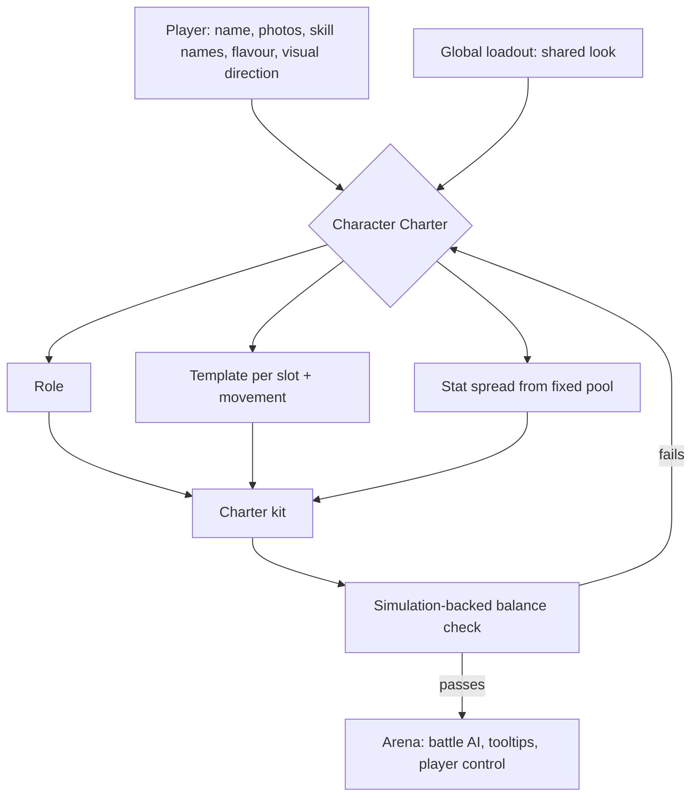
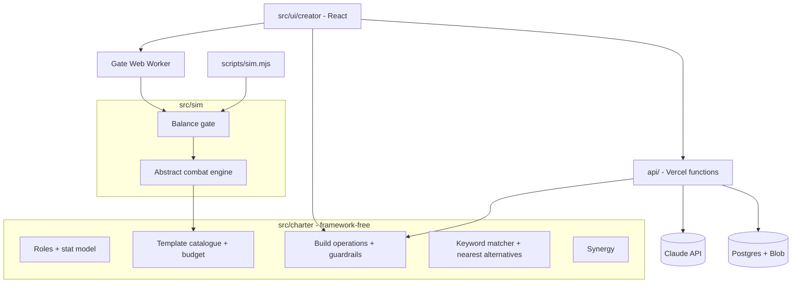
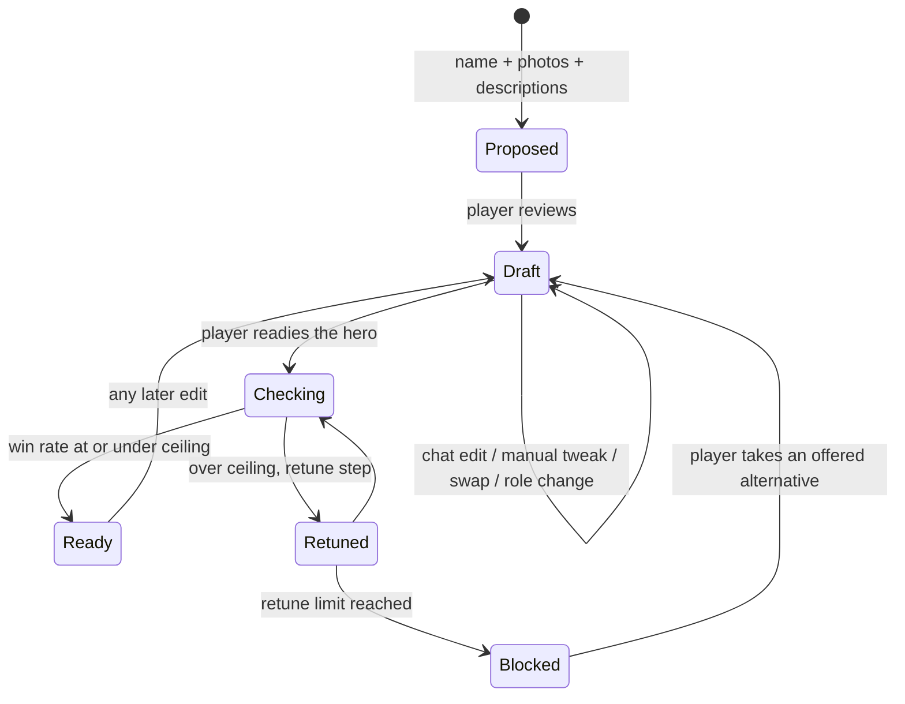

# Character Charter - Plan

**Target repo:** `psyblr-autobattler` (GitHub `timbresociety/psyblr-autobattler`, public). Greenfield.

## Goal Capsule

- **Objective:** Any hero a player brings (a name, reference photos and flavour text) enters a 3D arena brawl with a fair, readable kit. A streamer's staged matchup, such as AI CEOs vs Superintelligence cyborgs or DBZ vs One Piece, is then decided by squad choices and play, not by who wrote the strongest prompt.
- **Means:** A framework-free Charter core shared by a conversational creator, a headless balance simulation, and server functions (KTD1).
- **Product authority:** The owner. This plan owns the Character Charter only. Hero Forge (avatar and animation generation), the Arena (combat, controls, battle AI), the game modes and the visual bar are surrounding areas and are not active scope. Product Contract wins on behavior; Planning Contract KTDs win on mechanism.
- **Open blockers:** None.
- **Stop conditions:** Stop and ask the owner if a requirement cannot be met as written, if the balance gate cannot bring the reference field under the R15 ceiling after retuning, or if a change would need real 3D rendering, auth, or payments.
- **Execution profile:** Deep. Twelve units in four phases. Charter core first, then simulation, then server, then UI.
- **Tail ownership:** The executor commits per unit and pushes to `origin` (`timbresociety/psyblr-autobattler`, public). Never commit secrets: `ANTHROPIC_API_KEY` and database URLs live only in Vercel env and an ignored `.env.local`.

---

## Product Contract

### Summary

The Character Charter is the engine layer that turns any player-made hero into a standard kit: a basic attack, 2 actives, a passive, an ultimate and a movement template, plus layered stats bought from one fixed point pool.
The player owns the look, the names and the flavour. The engine owns every number.
Creation is a conversation, and the stat split and skill tooltips are always on screen, so a player can fine-tune within the same guardrails.

### Problem Frame

Generative AI can turn "Jensen", "Goku" or "a Superintelligence cyborg" into a convincing avatar in minutes. That makes the fantasy cheap and the fairness hard.
If players can describe power, the strongest prompt wins every matchup, and a staged battle stops being worth watching.
Dota 2 and League of Legends show that standard attributes and kit shapes keep large rosters fair. Deadlock, Overwatch 2 and Marvel Rivals show how deep a 3D kit can play.
No existing game lets anyone bring an army of their favourites and still get a fair fight. The Charter is the missing layer between "describe your hero" and "watch them fight".

### Key Decisions

- **Player input is cosmetic only, and the engine owns power.** The skill keeps the player's name and visuals, and a standard template sets what it does. (session-settled: user-directed — chosen over "keep the fantasy, pay the price", silent reinterpretation, and pushing back to ask again: power must be kept in check by the engine, while "Rewind" stays "Rewind" with custom animation and aura.) Governs R3, R4, R5.
- **Mix-and-match templates per slot.** (session-settled: user-directed — chosen over archetype kits of roughly 30 hand-tuned whole kits: maximum variety between heroes.) It makes the simulation-backed check a core part of the Charter. Governs R5, R8, R15.
- **The template is visible and can be swapped among close fits.** (session-settled: user-approved — chosen over final or hidden picks: opponents and streamers must be able to read a matchup.) Governs R6, R7.
- **Roles are standard, assigned by the engine and changeable by the player.** (session-settled: user-directed — chosen over player-picked-first, emergent or primary-attribute roles: the engine assigns, and the player can later change how the hero takes part in the fight.) Governs R9, R10.
- **Shared look, own build.** (session-settled: user-approved — chosen over exact locked copies and several ranked variants: generation is paid once and tuning is free.) Governs R18.
- **Soft army synergy with no hard caps.** (session-settled: user-approved — chosen over hard role limits and single-hero-only balance: themed armies stay legal while degenerate stacks lose.) Governs R16.
- **No limits on who can be forged.** (session-settled: user-directed — chosen over gated public sharing, inspired-by-only and self-and-friends-only: the owner accepts takedown and platform risk.) Governs R19.
- **A 3D arena brawler, not a MOBA.** The fights are in the vein of Dragon Ball Sparking! Zero, with Deadlock's range of motion. (session-settled: user-directed — chosen over literal MOBA-style play: avoid a lanes-and-towers feel.) Governs R1, R2.
- **Deadlock-level depth is the demo minimum.** This means mechanic variety, stat sheet depth and readable tooltips, without in-match growth. (session-settled: user-directed — chosen over a smaller first cut: anything less won't make staged matchups feel fair and distinct.) Governs R6, R8, R11.
- **Conversational creation with a visible stat split and manual UI controls.** (session-settled: user-directed — chosen over conversation-only adjustment: players must see the split and be able to tweak it by hand within the engine's guardrails.) Governs R13, R14.

### Requirements

**Kit shape**

- R1. Every hero has the same kit shape: one basic attack (melee or ranged), two active skills, one passive, one ultimate and one movement template.
- R2. Every hero shares a movement baseline with Deadlock-level range of motion (for example dashes, jumps and air movement), and the hero's movement template adds to it rather than replacing it.

**What the player owns vs what the engine owns**

- R3. The player authors the hero's name, reference photos, skill names, skill flavour descriptions and visual direction (animation, aura, VFX), and nothing the player authors changes a power number.
- R4. The engine owns every template choice, number, stat cap and point value, and no hero can exceed the standard power budget.

**Skill translation**

- R5. For each slot, the engine maps the player's skill description to a mechanic template from the hero's role pool for that slot, keeping the player's skill name and visuals unchanged.
- R6. Every skill shows a readable tooltip with exact numbers (damage, range, cooldown, scaling) to its owner and to opponents.
- R7. For each slot, the player can swap the chosen template for one of the 2–3 nearest alternatives in that role's pool.
- R8. The template library is large enough that heroes in a 10-hero army play distinctly, targeting roughly 100+ distinct mechanics across roles for the demo.

**Roles**

- R9. The Charter defines a standard set of roles, and the engine assigns one to each new hero from its name, photos and descriptions.
- R10. The player can change a hero's role at any time; each slot then re-maps to a template from the new role's pool, cosmetics stay, and stat points return to the pool.

**Stats**

- R11. Core attributes (in the spirit of strength, agility and intelligence) feed a layered secondary stat sheet at Deadlock depth, covering at least move speed, attack speed, weapon damage, armor, magic resistance, regen, lifesteal and cooldown reduction.
- R12. Every hero spends the same fixed pool of stat points, the engine proposes the initial spread, and each stat has a per-stat cap.

**Creation experience**

- R13. Creation is conversational first: from a name and reference photos, the engine proposes a role, templates and a stat spread, and the player adjusts by asking in plain language.
- R14. The stat split and all skill tooltips are always visible, and the player can tweak stats and swap templates directly in the UI under the same guardrails as conversational edits, with every change updating the split and tooltips live.

**Balance**

- R15. No build can enter battle until it passes a simulation-backed check that keeps its win rate against the field at or below a set ceiling, starting at 55%.
- R16. Any 10 heroes may form an army; stacking the same role gives growing drawbacks, and mixed armies get small team bonuses.
- R17. Every template carries usage guidance for the battle AI, so a hero plays its kit sensibly in watch mode and when the player switches away from it.

**Shared heroes and likeness**

- R18. Typing a hero name surfaces matching heroes already in the global loadout; adding one is free and gives the player the shared look plus their own copy of the build to tune.
- R19. The Charter accepts any hero regardless of whose likeness it uses, with no restriction on real people or existing characters.



### Key Flows

- F1. Forge a new hero's kit
  - **Trigger:** The player names a new hero and adds reference photos.
  - **Steps:** The engine proposes a role, a template for each slot and a stat spread. The player describes each skill's name and flavour. The engine maps each description to a template, and the player reviews the tooltips, then asks for changes or tweaks them in the UI. The build passes the balance check and joins the loadout.
  - **Covered by:** R3, R5, R6, R9, R12, R13, R14, R15
- F2. Add a hero from the global loadout
  - **Trigger:** While typing a name, the player sees an existing hero with that name.
  - **Steps:** The player adds the hero for free, gets their own copy of the build, and re-tunes role, stats or templates as in F1.
  - **Covered by:** R18, R10, R14
- F3. Change a hero's role
  - **Trigger:** The player wants the hero to take part in fights differently.
  - **Steps:** The player picks a new role. Each slot re-maps to the new role's pool, and the points return to the pool. The engine proposes a new spread, and the build is checked again.
  - **Covered by:** R10, R12, R15

### Acceptance Examples

- AE1. **Covers R3, R5, R6.** Given a Mage hero with a skill named "Rewind" described as "rewind the last 5 seconds of the fight", when the engine maps it, then the skill keeps the name "Rewind" and its custom visuals, runs a standard template (for example, return to your position from a few seconds ago plus a small heal), and shows that template's exact numbers in its tooltip.
- AE2. **Covers R4, R13.** Given a player who asks "make him unkillable", when the engine responds, then no stat or template goes past its cap, and the engine says what limit was hit and offers the closest allowed change.
- AE3. **Covers R10.** Given "Rewind" on a Mage, when the player changes the role to Tank, then "Rewind" keeps its name and visuals, maps to a template from the Tank pool (for example, a shield), and all stat points return to the pool.
- AE4. **Covers R14, R12.** Given the stat split is on screen, when the player drags armor past its cap or spends more than the pool allows, then the UI stops at the guardrail and the split and tooltips show the last valid state.
- AE5. **Covers R15.** Given a combination of templates whose simulated win rate against the field is above the ceiling, when the player tries to take that build into battle, then the build cannot enter until it is back under the ceiling.
- AE6. **Covers R16.** Given an army of 10 Supports, when the battle starts, then the army is allowed, and each Support beyond the stacking threshold has weaker effects.
- AE7. **Covers R18.** Given player A adds "Jensen" from the global loadout and changes the role, when player B adds "Jensen", then B gets the same look with the original build, unaffected by A's changes.

### Success Criteria

- In simulation, no legal build or army composition beats the field above the win-rate ceiling in R15.
- A streamer can read what any hero in an opponent's army does from the tooltips alone, before the battle starts.
- A player can go from a name and photos to a battle-ready kit through conversation only, without touching the manual controls.
- In a typical 10-hero army, no two heroes share the same set of templates unless the player chose that on purpose.

<!-- ce-section: work-relationships -->
### How This Work Fits Together

This plan owns the Character Charter. The breakdown below is the current understanding, not a committed roadmap.

- Hero Forge (name and photos in, 3D avatar and animations out, Tripo-style generation, the paid "build from scratch" flow)
  - Enables the Charter's cosmetic layer; the Charter consumes the Forge's output.
  - Still to decide: how per-skill custom animations attach to standard templates.
- The Arena (third-person auto-battle with FIFA-style switching to control one hero at a time)
  - Depends on the Charter's kits, tooltips and AI usage guidance (R6, R17).
  - Can proceed independently of the Forge by using hand-made heroes.
- Game modes (campaign of 10 vs system enemies in a "tournament of power", 1v1 multiplayer with 10-hero armies, local 10v10 where the player controls one side)
  - Depend on the Arena and the Charter's army rules (R16).
- The visual bar (WebGPU, high-poly characters, animation, environments and HUD at AAA level)
  - Shares a budget with every area above. Still to decide in its own brainstorm.
- Universe traits (shared mechanics per universe, such as transformations or crew bonds)
  - Depends on the Charter's soft synergy (R16). Deferred as the first expansion.

### Scope Boundaries

**Deferred for later**

- Universe traits (transformations, crew bonds, shared universe mechanics).
- In-match growth: levelling, skill upgrade tiers, items or a shop.
- Hero Forge generation, Arena combat and controls, the game modes, pricing and payments. Each gets its own brainstorm.

**Outside this product's identity**

- MOBA structure: lanes, creeps, towers, top-down play.
- Buying or prompting power. Money and words change looks, never numbers.

**Deferred to Follow-Up Work**

- Player accounts and auth. The demo uses an anonymous device ID (KTD9).
- Server-side re-run of the balance gate to prevent cheating in multiplayer. It is needed once multiplayer exists.
- Re-calibrating the simulation against the real Arena (KTD6).

### Dependencies / Assumptions

- Likeness risk is accepted. Because R19 puts no limits on who can be forged, there is ongoing takedown, store-listing and payment-provider risk, and the owner accepts it.
- The Forge must give every generated hero a rig that standard template animations can run on, with per-hero visual flavour on top. The Charter assumes this and does not solve it.
- Template numbers live centrally, so when the engine rebalances a template, every hero using it updates.
- The demo has no in-match growth, so a hero's Charter kit is fixed for the whole battle.

### Outstanding Questions

The planning questions from the brainstorm are resolved in the Planning Contract: retune-then-block (KTD7), role list (KTD4), stat model (KTD3), synergy shape (KTD8), simulation (KTD6, KTD7), and matching and ranking (KTD5).

**Deferred to Implementation**

- Exact numeric values: pool size, per-stat caps, budget weights, synergy threshold and bonus sizes. Set them in data, then tune them against the U8 balance report.

### Sources / Research

- Reference games named by the owner: Dota 2 and League of Legends (standard attributes and kits), Deadlock (kit depth, range of motion, readable tooltips), Overwatch 2 and Marvel Rivals (3D skill play), Dragon Ball Sparking! Zero (arena brawl feel), EA FC/FIFA (character builder, switching player control), Teamfight Tactics (soft role synergy).

**Product Contract preservation:** Product Contract unchanged. Deferred-to-Planning questions are resolved in place by KTD3 to KTD8. Only numeric values remain deferred to implementation.

---

## Planning Contract

### Key Technical Decisions

- KTD1. **One Vite + TypeScript + React app. The Charter core is a framework-free module.** The same core runs in the browser creator, the Node balance simulation, and Vercel functions, so a rule has one implementation. The stack mirrors the owner's SoloUnicorn project (Vite, React, Vitest, a `sim` script, Vercel). No monorepo.
- KTD2. **Templates are typed data with a power-budget score.** Each template declares its slot, role pools, mechanic tags, effect parameters, battle-AI usage hints and an animation hook ID. A budget formula derives starting numbers so every template in a slot costs the same budget. Hand-tuned overrides are allowed and are recorded in the data. Builds store template IDs plus engine-written retune steps (KTD7), never raw numbers, so a catalogue patch updates every hero (Assumption: central numbers).
- KTD3. **Stat model: three core attributes feed a derived secondary sheet.** The core attributes are Strength, Agility and Intellect. The secondary sheet covers at least the stats R11 lists, plus ammo, fire rate and spirit power. Each role sets base values, attribute-to-secondary weights and per-stat caps. All heroes spend one equal pool (R12).
- KTD4. **Six roles: Tank, Fighter, Assassin, Mage, Marksman, Support.** Each role owns a template pool for every slot, including movement.
- KTD5. **Claude proposes and the catalogue disposes.** A server function sends the hero name, photo captions and skill descriptions to Claude through structured tool output. Claude may return only a role ID, template IDs from a role-filtered catalogue, and a stat spread. The core validates and clamps everything Claude returns, so the model never sets a number outside the guardrails (R4). A keyword-and-tag matcher gives the same output shape offline and in tests. "Nearest alternatives" (R7) rank the same slot's role pool by tag overlap with the chosen template and the player's description. The exact Claude model is chosen at implementation from the current model list.
- KTD6. **Balance runs on a headless, deterministic, abstract combat model.** It models positions on a 2D plane, movement speed, range, cooldowns, damage over time, crowd control, shields and healing. It does not model 3D physics. A seeded random number generator makes runs reproducible. The battle AI reads each template's usage hints (R17). The model must be re-calibrated once the Arena exists. That re-calibration is recorded as a risk, not done in this plan.
- KTD7. **Balance gate: retune, then block.** The gate runs a build against a reference field of seeded opponent builds. If the win rate is above the R15 ceiling, the engine scales the build's template numbers down in budget steps, up to a retune limit, and checks again. The steps are stored per slot on the Build as `retuneSteps`. Only the gate writes them, and player input can never set them. Tooltips and the simulation apply catalogue numbers scaled by those steps. If the build is still above the ceiling, it is blocked. The creator then offers the nearest alternatives for the strongest slot. Tooltips always show the post-retune numbers. In the browser the gate runs in a Web Worker. The `sim` script runs the same gate over the whole catalogue.
- KTD8. **Synergy has diminishing returns per role.** For each role above a stacking threshold, that role's effects scale down by a step for every extra hero. Armies with at least a minimum number of distinct roles get a small team-wide bonus. All values live in data.
- KTD9. **A minimal shared backend: Vercel functions, Postgres from the Vercel Marketplace (Neon), and Vercel Blob for photos.** A shared Hero record holds the look (name, photos, skill names, flavour, visual direction). A Build record holds one player's role, template choices and spread. Players are identified by an anonymous device ID. The server issues it as a random 128-bit token, and the client stores it. A player can read or write a Build only when their ID owns it. Hero and search responses never include device IDs. Accounts, payments and moderation are out of scope (Scope Boundaries).
- KTD10. **The creator is 2D React.** The avatar slot shows the first reference photo. The 3D preview arrives with the Forge and the visual bar.

### High-Level Technical Design

Component topology. The core is the single owner of rules. Each surface consumes it.



Build lifecycle. Every edit returns the build to Draft, so the gate always sees the final shape.



Proposal data flow (directional):

```text
inputs (name, photo captions, skill names + descriptions)
  -> propose(): Claude tool call, or keyword matcher offline
       returns { roleId, templateIds per slot, spread }
  -> core.validate(): unknown IDs -> matcher pick; spread -> clamp to caps and pool
  -> Build (Draft) + tooltips rendered from catalogue numbers
```

### Output Structure

```text
psyblr-autobattler/
  package.json, vite.config.ts, tsconfig.json, vercel.json, .env.example
  src/
    charter/        types, roles, stats, budget, build, match, synergy, tooltip
      templates/    tank, fighter, assassin, mage, marksman, support, movement, catalog
    sim/            rng, engine, ai, field, gate, gate.worker
    server/         propose (Claude), store (Postgres), blob
    ui/creator/     CreatorScreen, ChatPanel, StatSplit, SkillCard, RoleSwitcher, GateStatus, LoadoutSearch
    ui/api.ts
  api/              charter/propose.ts, heroes/search.ts, heroes/index.ts, builds/index.ts, photos/upload.ts
  scripts/sim.mjs
  db/schema.sql
```

### Sequencing

- **Phase A, the Charter core:** U1, U2, U3, U4, U5, U6.
- **Phase B, balance:** U7, U8.
- **Phase C, server:** U9, U10.
- **Phase D, creator:** U11, U12.

U4 (content) follows U3. U6 (matcher) follows U4, and U5 follows U4 and U6.

### Risks & Dependencies

| Risk | Mitigation |
|---|---|
| The abstract simulation diverges from the real 3D Arena | Keep combat parameters in one calibration file. Re-run the full `sim` report when the Arena lands. |
| 100+ templates make a large combination space; the gate samples it rather than proving it | The catalogue-wide `sim` report flags the most dangerous pairs. Per-build gating still catches what the sample misses. |
| Authoring 100+ templates is heavy content work | The budget formula sets starting numbers. Templates are compact data with tag-driven descriptions. |
| Claude latency or outages | The offline matcher returns the same output shape. The creator stays usable without the API. |
| Likeness, takedown and platform risk (R19) | Accepted by the owner. No mitigation in this plan. |
| Public repo leaks secrets | `.env*` is git-ignored, and `.env.example` holds names only. Keys live in Vercel env. |

### Sources / Research

- Owner's sibling project `solounicorn-game` for stack conventions (Vite, React 19, Vitest, `sim` script, Vercel).
- External research skipped: this plan renders no 3D, and the WebGPU stack belongs to the visual-bar plan.

---

## Implementation Units

| U-ID | Title | Key files | Depends on |
|---|---|---|---|
| U1 | Project scaffold | `package.json`, `vite.config.ts`, `vercel.json` | — |
| U2 | Roles and stat model | `src/charter/roles.ts`, `src/charter/stats.ts` | U1 |
| U3 | Template schema, budget, tooltips | `src/charter/types.ts`, `src/charter/budget.ts`, `src/charter/tooltip.ts` | U2 |
| U4 | Template library content | `src/charter/templates/*` | U3 |
| U5 | Build operations and guardrails | `src/charter/build.ts` | U3, U4, U6 |
| U6 | Matcher and nearest alternatives | `src/charter/match.ts` | U3, U4 |
| U7 | Abstract combat engine and battle AI | `src/sim/engine.ts`, `src/sim/ai.ts` | U4, U5 |
| U8 | Balance gate, retune, synergy, sim report | `src/sim/gate.ts`, `src/charter/synergy.ts`, `scripts/sim.mjs` | U7 |
| U9 | Claude proposer function | `src/server/propose.ts`, `api/charter/propose.ts` | U5, U6 |
| U10 | Shared hero store and global loadout API | `src/server/store.ts`, `api/heroes/*`, `db/schema.sql` | U5 |
| U11 | Creator screen | `src/ui/creator/*` | U8, U9, U10 |
| U12 | Global loadout search and add flow | `src/ui/creator/LoadoutSearch.tsx` | U10, U11 |

### U1. Project scaffold

**Goal:** Create a running Vite + React + TypeScript app with Vitest, a `sim` script entry and Vercel config.
**Requirements:** Enables all; KTD1.
**Dependencies:** None.
**Files:** `package.json`, `tsconfig.json`, `vite.config.ts`, `vitest.setup.ts`, `vercel.json`, `.gitignore`, `.env.example`, `index.html`, `src/main.tsx`, `README.md`.
**Approach:**
1. Mirror the SoloUnicorn scripts: `dev`, `build`, `test`, `typecheck`, `sim`.
2. Git-ignore `.env*` except `.env.example`.
3. Keep `src/charter/` and `src/sim/` free of DOM and React imports, enforced by a lint rule or a test (U2).
**Test expectation:** none -- scaffolding. Verify by a passing `npm run typecheck`, `npm test` and `npm run build` on the empty app.
**Verification:** The dev server renders a placeholder creator route.

### U2. Roles and stat model

**Goal:** Define the six roles, the three core attributes, the derived secondary sheet, the equal pool and the per-stat caps.
**Requirements:** R9, R11, R12; KTD3, KTD4.
**Dependencies:** U1.
**Files:** `src/charter/roles.ts`, `src/charter/stats.ts`, `src/charter/types.ts`, `src/charter/stats.test.ts`, `src/charter/purity.test.ts`.
**Approach:** Role data holds base values, attribute-to-secondary weights and caps. `deriveSheet(role, spread)` is pure. A purity test fails if any file under `src/charter/` or `src/sim/` imports React or touches the DOM.
**Test scenarios:**
- A spread that spends the full pool derives a sheet with every secondary stat inside its role cap.
- The same spread on Tank and on Assassin gives different sheets, because role weights differ.
- A spread above the pool total is rejected with a pool-exceeded reason.
- A negative point value is rejected.
- Every role defines every secondary stat (no undefined fields).
- The purity test fails on a deliberate React import fixture.
**Verification:** The sheet derivation is deterministic, and all roles are complete.

### U3. Template schema, power budget, tooltips

**Goal:** Define the template data shape, the budget formula and the tooltip text built from template numbers.
**Requirements:** R4, R6; KTD2.
**Dependencies:** U2.
**Files:** `src/charter/types.ts`, `src/charter/budget.ts`, `src/charter/tooltip.ts`, `src/charter/budget.test.ts`, `src/charter/tooltip.test.ts`.
**Approach:** A template has a slot, role pools, tags, effect parameters, scaling with core attributes, AI usage hints and an animation hook ID. The budget formula scores effect parameters (damage per second equivalent, control seconds, mobility, sustain), weighted by cooldown. Tooltips show the player's skill name with the template's real numbers (R6).
**Test scenarios:**
- Two templates in the same slot normalized by the formula score within the budget tolerance.
- A template with an override records the override and its reason, and the score reflects the override.
- The tooltip for a player skill named "Rewind" shows "Rewind" plus damage, range, cooldown and scaling from the template. Covers AE1.
- A tooltip under a derived sheet shows numbers scaled by that sheet's attributes.
- A template missing AI usage hints fails schema validation.
**Verification:** Every slot's budget is consistent, and tooltips render for every slot type.

### U4. Template library content

**Goal:** Author at least 100 distinct mechanics across six roles and all slots, plus movement templates, each with tags and AI hints.
**Requirements:** R1, R2, R8, R17; KTD2, KTD4.
**Dependencies:** U3.
**Files:** `src/charter/templates/{tank,fighter,assassin,mage,marksman,support,movement}.ts`, `src/charter/templates/catalog.ts`, `src/charter/templates/catalog.test.ts`.
**Approach:**
1. Give each role's pool at least 2 basic attacks (melee and ranged where the role fits), 6 actives, 3 passives, 3 ultimates and 2 movement templates.
2. Templates may sit in more than one role pool.
3. Movement templates add to the shared baseline (dash, jump, air movement) and do not replace it (R2).
4. Mechanics follow an arena-brawler vocabulary: beams, rushes, blinks, grapples, zones, shields, rewinds and transformations-as-buffs.
**Test scenarios:**
- The catalogue holds 100 or more distinct mechanics (unique effect-parameter signatures, not just unique IDs).
- Every role has at least 3 options for every slot, so R7 always has 2 to 3 alternatives.
- Every template passes U3 schema and budget validation.
- No two templates share identical effect parameters.
- Every movement template composes with the baseline, and the baseline stays available.
**Verification:** The catalogue test passes, and the catalogue loads in both the browser and Node.

### U5. Build operations and guardrails

**Goal:** Implement every build edit (propose, allocate, swap, role change, chat-edit application) under one guardrail validator.
**Requirements:** R3, R4, R7, R10, R12, R14; F1, F3; AE2, AE3, AE4.
**Dependencies:** U3, U4, U6.
**Files:** `src/charter/build.ts`, `src/charter/build.test.ts`.
**Approach:** A Build holds the hero reference, role ID, template ID per slot, `retuneSteps` per slot (gate-written only, KTD7), spread and gate state. Every operation returns either a new valid Build or a typed rejection that names the hit limit and the closest allowed value. Changing the role re-maps each slot through the U6 matcher against the slot's stored description, refunds all points and proposes a new spread.
**Test scenarios:**
- Allocating points past a stat cap clamps to the cap and returns the limit. Covers AE4.
- Spending more than the pool is rejected, and the build stays at its last valid state. Covers AE4.
- A request that maps to "max armor, max regen, max health" clamps each value to its cap and reports which limits were hit. Covers AE2.
- Changing a Mage with "Rewind" to Tank keeps the skill name and visual direction, picks a Tank-pool template, and returns all points to the pool. Covers AE3.
- Swapping to a template outside the 2 to 3 offered alternatives is rejected.
- No operation accepts a numeric power field from input. A payload with injected damage numbers or `retuneSteps` is ignored. Covers R4.
- Every operation resets the gate state to Draft.
**Verification:** Every edit path goes through the one validator.

### U6. Matcher and nearest alternatives

**Goal:** Map a skill description to a template for a slot and role offline, and rank the nearest alternatives.
**Requirements:** R5, R7; KTD5.
**Dependencies:** U3, U4.
**Files:** `src/charter/match.ts`, `src/charter/match.test.ts`.
**Approach:** Tokenize the description. Map words to mechanic tags through a synonym table (for example "rewind", "recall" and "time" to `return-to-past`). Score the slot's role pool by tag overlap. Break ties deterministically by template ID. Alternatives are the next 2 to 3 by score, plus tag overlap with the chosen template.
**Test scenarios:**
- "rewind the last 5 seconds" for a Mage active returns a `return-to-past` template. Covers AE1.
- An empty description returns the role's default template for that slot.
- The same input always returns the same template (determinism).
- Alternatives never include the chosen template and always come from the same slot and role pool.
- Unknown words do not throw. They fall back to the role default.
**Verification:** Matching works with no network.

### U7. Abstract combat engine and battle AI

**Goal:** Simulate seeded fights between builds on a 2D plane, with AI that plays each kit from its usage hints.
**Requirements:** R15, R17; KTD6.
**Dependencies:** U4, U5.
**Files:** `src/sim/rng.ts`, `src/sim/engine.ts`, `src/sim/ai.ts`, `src/sim/calibration.ts`, `src/sim/engine.test.ts`, `src/sim/ai.test.ts`.
**Approach:** Use a fixed-step loop that models position, movement, range, cooldowns, damage, control effects, shields, healing and death. The AI chooses targets and skills by hint priorities (for example "open with", "finisher under 30%" and "escape when low"). It supports 1v1 duels and team fights of up to 10v10. All tunable constants live in `calibration.ts`.
**Test scenarios:**
- The same seed and builds produce identical results across runs.
- A build with strictly higher damage and the same everything else wins the 1v1 duel more than half the time over 200 seeds.
- A stun stops the target's actions for exactly its duration.
- The AI uses a "finisher" ultimate only below its hinted health threshold.
- A 10v10 fight terminates within the time cap and reports a winner or a draw.
- A healer AI targets the lowest-health ally.
**Verification:** 1,000 seeded 1v1 fights run in under a few seconds in Node.

### U8. Balance gate, retune, synergy, simulation report

**Goal:** Gate builds against the R15 ceiling with retune-then-block, apply army synergy, and report on the whole catalogue.
**Requirements:** R15, R16; AE5, AE6; KTD7, KTD8.
**Dependencies:** U7.
**Files:** `src/sim/field.ts`, `src/sim/gate.ts`, `src/sim/gate.worker.ts`, `src/charter/synergy.ts`, `scripts/sim.mjs`, `src/sim/gate.test.ts`, `src/charter/synergy.test.ts`.
**Approach:** The reference field is seeded builds spread across roles. The gate runs N duels per field member, retunes by budget steps up to the limit, then passes or blocks. When it blocks, it returns the strongest slot and that slot's alternatives. Synergy modifiers apply in team fights. `npm run sim` runs the gate over sampled catalogue builds and prints the worst offenders, the pair hot spots and the template distinctness figure from the Success Criteria. It also runs seeded 10-hero armies, including mono-role stacks and themed mixes, against a reference army field with synergy applied. It reports the worst army compositions. The in-browser gate stays per-build.
**Test scenarios:**
- A deliberately overtuned fixture build is retuned under the ceiling and passes, with lowered tooltip numbers.
- A fixture that stays over the ceiling after the retune limit is blocked and returns the strongest slot plus alternatives. Covers AE5.
- A normal catalogue build passes without retuning.
- An army of 10 Supports is allowed, and Supports above the threshold have scaled-down effects. Covers AE6.
- An army meeting the distinct-role minimum gets the team bonus, and a mono-role army does not.
- The worker and Node paths return identical gate results for the same seed.
- A retuned build stores its `retuneSteps`, and reloading it shows the same lowered tooltip numbers.
- A fixture army that exploits stacking above the ceiling makes the army run fail.
**Verification:** `npm run sim` exits non-zero if any reference-field build or sampled army exceeds the ceiling.

### U9. Claude proposer function

**Goal:** Turn a name, photo captions and skill descriptions into a role, templates and a spread, through Claude with validation.
**Requirements:** R5, R9, R13, R4; F1; KTD5.
**Dependencies:** U5, U6.
**Files:** `src/server/propose.ts`, `api/charter/propose.ts`, `src/server/propose.test.ts`.
**Approach:** Build a tool schema whose enums list valid role IDs and the template IDs for each slot. Send the inputs and parse the tool call. Pass the result through U5 validation. If the call fails or returns invalid IDs, use the U6 matcher for those slots. Chat edits ("more agile, less armor") use the same function with the current build and return a spread or a swap, never numbers. Read `ANTHROPIC_API_KEY` from env.
Abuse limits:
1. Cap input sizes (name, each skill description, chat message, photo count), and reject oversize requests.
2. Rate-limit `api/charter/propose` per device ID and per IP.
3. Over the limit, return the matcher-only `offline` proposal and do not call Claude.
**Test scenarios:**
- An oversize skill description is rejected before any Claude call.
- A device over its rate limit gets an `offline` proposal, and Claude is not called.
- With the API mocked to return valid IDs, the result is a valid Draft build.
- With the API mocked to return an unknown template ID, that slot falls back to the matcher.
- With the API mocked to return a spread over the pool, the spread is clamped.
- An API timeout returns a matcher-only proposal flagged `offline`.
- A chat edit "more agile, less armor" moves points from armor-feeding attributes to Agility within caps.
- The response never contains a numeric power field taken from model output.
**Verification:** The function works with the key and degrades without it.

### U10. Shared hero store and global loadout API

**Goal:** Persist shared Hero looks and per-player Builds, and serve name search for the global loadout.
**Requirements:** R18, R19; F2; AE7; KTD9.
**Dependencies:** U5.
**Files:** `db/schema.sql`, `src/server/store.ts`, `src/server/blob.ts`, `api/heroes/search.ts`, `api/heroes/index.ts`, `api/builds/index.ts`, `api/photos/upload.ts`, `src/server/store.test.ts`.
**Approach:** Hero records are immutable after creation and are owned by their creator's device ID. Each Hero stores an immutable `originalBuild` snapshot (role ID, template IDs, spread) of the creator's first gated build. Build records reference a Hero ID and a device ID. Adding a Hero from the global loadout creates a new Build copied from `originalBuild`. Search is a case-insensitive prefix and similarity match on name. There is no likeness filter (R19). Ownership and device-ID handling follow KTD9.
Photo upload limits:
1. Set a maximum file size and a maximum number of photos per Hero.
2. Check the real file type by its content bytes against JPEG, PNG and WebP.
3. Re-encode on the server or strip metadata.
4. Store under a random server-made name with a fixed image content type.
5. Rate-limit uploads per device ID and per IP.
`store.test.ts` runs `db/schema.sql` against an in-process Postgres (PGlite) through the same store interface. Real Neon is used only by the API smoke gate.
**Test scenarios:**
- Search "jen" returns "Jensen" heroes ranked by use count.
- The creator edits their own Jensen build, and player B adding Jensen later still gets the `originalBuild` snapshot. Covers AE7.
- A file whose content bytes are not an allowed image type is rejected, even with an image extension.
- An upload over the size limit is rejected.
- A device cannot read or write another device's Build.
- Search and Hero responses contain no device IDs.
- Adding a hero creates a Build and does not duplicate the Hero.
- Uploading a non-image file is rejected, and an image is stored with a Blob URL on the Hero.
- A Build request with an unknown Hero ID returns not-found.
- Saving a Build re-validates it through U5 on the server.
**Verification:** The API works against a local Postgres and the Vercel preview database.

### U11. Creator screen

**Goal:** Deliver the conversational creator, with the always-visible stat split, skill cards, role switching, manual tweaks and gate status.
**Requirements:** R3, R6, R7, R10, R13, R14, R15; F1, F3; AE1 to AE5.
**Dependencies:** U8, U9, U10.
**Files:** `src/ui/creator/CreatorScreen.tsx`, `ChatPanel.tsx`, `StatSplit.tsx`, `SkillCard.tsx`, `RoleSwitcher.tsx`, `GateStatus.tsx`, `src/ui/api.ts`, `src/ui/creator/*.test.tsx`.
**Approach:**
1. Left panel: the chat, which is the primary path.
2. Right panel: the photo avatar, role, stat split bars with caps and pool remaining, and five skill cards plus a movement card. Each card shows the player's name, flavour and live tooltip, with a swap menu of alternatives.
3. Manual edits and chat edits call the same U5 operations (R14).
4. Each skill card has inline editing for the skill name, flavour description and visual direction (R3). Editing a description re-runs the matcher only for a slot the player has not swapped by hand. For a hand-swapped slot, the creator asks before replacing the template.
5. "Ready" runs the gate in the worker and shows retune or block results with the offered alternatives.
**Test scenarios:**
- Entering a name and photo and sending the first message renders a proposed role, six cards and a stat split. Covers F1.
- Dragging a stat bar past its cap stops at the cap and shows the limit message. Covers AE4.
- Asking "make him unkillable" shows the limit reached and the closest allowed change. Covers AE2.
- Switching role to Tank keeps the skill names and visuals, shows new tooltips and refills the pool. Covers AE3.
- The swap menu shows 2 to 3 alternatives, and choosing one updates the tooltip live.
- A blocked gate result shows the strongest slot and its alternatives, and "Ready" stays disabled until the build passes. Covers AE5.
- With the API offline, the creator still proposes a kit and shows an offline notice.
- Editing an unswapped skill's description re-matches its template, and editing a hand-swapped skill's description asks before replacing it.
**Verification:** A player goes from name and photos to a Ready build through chat only (Success Criteria).

### U12. Global loadout search and add flow

**Goal:** Surface existing heroes while the player types a name, add them for free, and show the player's loadout.
**Requirements:** R18; F2; AE7.
**Dependencies:** U10, U11.
**Files:** `src/ui/creator/LoadoutSearch.tsx`, `src/ui/creator/Loadout.tsx`, `src/ui/creator/LoadoutSearch.test.tsx`.
**Approach:** Run a debounced search on the name field. Each result shows the photo, the name, the creator's role and a "Add free" action. Adding a hero opens it in the creator as the player's own build. "Build my own" continues to the full creation flow.
**Test scenarios:**
- Typing "Jen" lists matching heroes within the debounce window.
- "Add free" creates a build and opens it in the creator with the shared look. Covers F2.
- Editing the added build does not change the shared hero's original build. Covers AE7.
- With no matches, only "Build my own" shows.
- A search failure shows an inline retry and does not block creation.
**Verification:** The loadout lists every hero the device has added or built.

---

## Verification Contract

| Gate | Command | Applies to |
|---|---|---|
| Types | `npm run typecheck` | All units |
| Unit and component tests | `npm test` | U2 to U12 |
| Balance report | `npm run sim` (non-zero exit on any reference build over the R15 ceiling) | U7, U8, any template or calibration change |
| Production build | `npm run build` | U1, U11, U12 |
| API smoke | Run the `api/` functions with `vercel dev` against a local or preview Postgres; propose, search, add and save a build | U9, U10 |

The Success Criteria in the Product Contract are checked by the `sim` report (ceiling and template distinctness) and by a manual chat-only creation run (U11).

---

## Definition of Done

- Every R1 to R19 traces to at least one passing test or verification step in its unit.
- `npm run typecheck`, `npm test`, `npm run sim` and `npm run build` pass on a clean checkout.
- The catalogue holds 100 or more distinct mechanics, and every role has at least 3 options in every slot.
- No secret appears anywhere in git history. `.env.example` lists the names of required variables only.
- Each unit is committed and pushed to `origin` on `timbresociety/psyblr-autobattler`.
- Code from abandoned approaches and experiments is removed and does not stay in the diff.

---

## Deferred / Open Questions

### From 2026-10-22 review

- **What a stat point buys: core attributes or individual stats** — Planning Contract, stat model (P1, design-lens + feasibility, confidence 75)

  The stat split screen and the point-allocation rules can't be built until this is settled. The stat model spends the point pool on Strength, Agility and Intellect and derives armor from them, but the stat-cap acceptance example has the player dragging armor directly. Recommended: points buy only the three core attributes, and secondary stats are read-only with their caps shown.

- **How reference photos reach Claude for role assignment** — Claude proposer (P1, adversarial + feasibility + design-lens, confidence 75)

  Without this, roles are assigned from the name and skill text only. The proposer is described as sending "photo captions", but nothing creates captions, because photos are only stored. Options: send the uploaded photos to Claude as images (recommended), or add an optional caption the player types for each photo.

- **No read-only hero card or army roster to show tooltips and synergy** — Creator screen (P1, design-lens, confidence 75)

  Streamers can't read an opponent's kit before a battle, and players can't see stacking penalties or team bonuses, even though the requirements say tooltips must be visible to opponents and synergy must be visible. No unit builds a view of someone else's hero or of a 10-hero army.

- **Chat edits have no defined behavior when Claude is offline** — Creator screen and Claude proposer (P1, design-lens, confidence 75)

  During an outage the main way to adjust a hero fails without saying so. The offline keyword matcher only maps skill descriptions, so a request like "more agile, less armor" can't be handled. Recommended: show "offline: use the controls" and move focus to the stat split and swap menus.

- **Ready badges go stale after catalogue or calibration patches** — Balance gate and the build lifecycle (P1, adversarial, confidence 75)

  Builds keep a balance pass they never earned against the current numbers. A catalogue patch changes every hero's power, but only player edits send a build back to Draft. Recommended: stamp each gate result with the catalogue, calibration and reference-field versions, and re-check when they don't match.

- **Role change collapses franchise skills to role defaults** — Build operations and matcher (P2, adversarial, confidence 75)

  Changing role turns a skill like "Kamehameha" into a generic default template, because re-mapping uses only the keyword matcher, which doesn't know franchise skill names. Recommended: re-map through the Claude proposer, keep the matcher as the offline fallback, and tell the player when a default was used.

- **Balance check has no checking state, cancel or retune summary** — Creator screen, gate status (P2, design-lens, confidence 75)

  Players wait on a long simulation with no feedback, and retuned numbers change silently. Recommended: a checking state with progress and cancel, a defined result for edits made during a check, and a summary of which slots were scaled down.

- **One click on role change wipes all tuning, with no confirmation or undo** — Creator screen, role switcher (P2, design-lens, confidence 75)

  A misclick on the always-visible role switcher loses the player's hand-tuned stat spread and template swaps. Recommended: confirm with a preview of the new templates, and offer a one-step undo.
