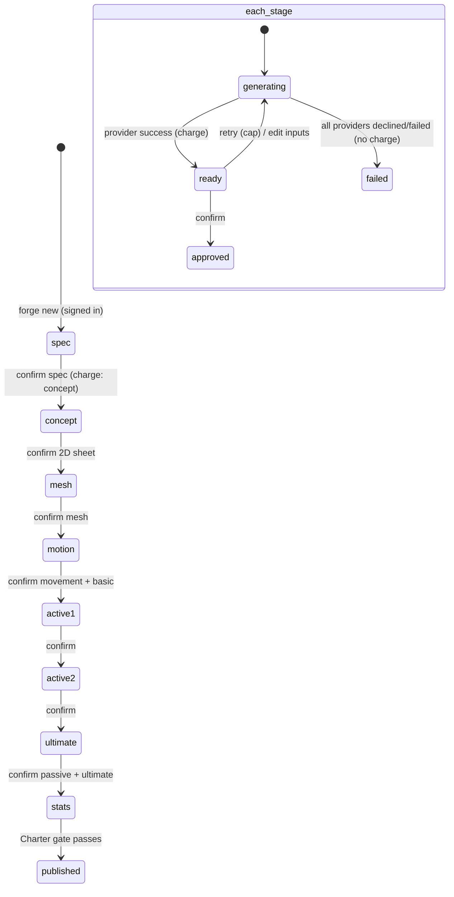
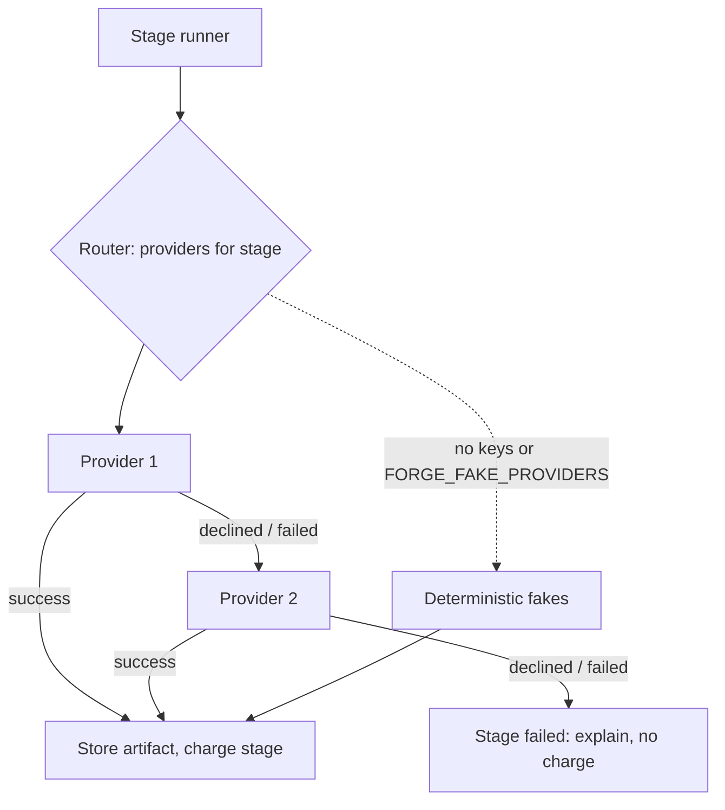

# Hero Forge - Plan

## Goal Capsule

- **Objective:** A player who can't find the hero they want in the global loadout can describe it in their own words and references and, in one guided session, get a rigged, animated, hyper-realistic hero that matches what they asked for, fills in what they didn't say with sharp cultural detail, and is ready to fight in any psyblr game.
- **Product authority:** The owner. This plan owns the Hero Forge: creation flow, cultural director, body, rig, movement and basic-attack motion, skill visuals, the hero asset, accounts and credits for forging. The Character Charter (`docs/plans/2026-10-22-1113-feat-character-charter-plan.md`, PR #1) is upstream and owns every number. The 3D Arena and the rendering pipeline are downstream and not active scope.
- **Means:** A persisted, stage-by-stage forge session on the server, with every external generator behind a provider adapter and router (KTD1, KTD2).
- **Open blockers:** None.
- **Stop conditions:** Stop and report if a settled decision proves unworkable, if `npm run sim` cannot be brought back under the ceiling after the size-class change, or if any step would need a paid live provider call (none are allowed while building).
- **Execution profile:** Deep. Twelve units in four phases: domain and Charter extension, providers and director, server and accounts, then UI.
- **Tail ownership:** The executor commits per unit on `feat/hero-forge-plan`, stacked on `feat/character-charter`. The pipeline (lfg) owns review, PR and CI.

**Target repo:** `psyblr-autobattler`. Builds on the Character Charter code on this branch.

---

## Product Contract

### Summary

Hero Forge is a plan-mode creation experience that starts at the global loadout. When nothing there fits, a cultural director turns the player's prompt and reference images into a confirmed spec sheet, then generates the hero stage by stage, and the player confirms each stage before the next one is paid for.
Every forged hero is a hyper-realistic humanoid in the house art style, with a rig, a motion set, and a visual for each of its six Charter skills, stored as a platform asset any psyblr game can load.

### Problem Frame

The Charter makes any hero fair, but a hero is still a photo on a card. Streamers and players come for the moment their idea comes to life: "Jensen as a Raiden-style GPU god with CUDA, Circle Jerk and Stonks skills" has to look and move like what they pictured, and it has to surprise them with details they didn't think to ask for.
One-shot generation fails this in two ways. It spends real money on guesses the player would have corrected. And it either ignores the cultural texture of the request or invents the wrong one. Generative 3D tools also have hard limits: the default provider (Tripo) rigs any humanoid in about 30 seconds but offers only 11 preset motions, renders real faces weakly, and produces no 2D sheets or effect sprites.
Some players will come for the forging experience alone and take their heroes into several psyblr games, so the Forge is a product in its own right, not a settings screen.

### Key Decisions

- **Plan-mode staged flow.** The Forge writes a plan, the player confirms each stage, and money is spent only after a confirm. (session-settled: user-directed — chosen over one-shot generation: the experience should feel like plan mode on Claude.) Governs R6, R11, R12.
- **The whole Forge stays in one plan.** Body, rig, motion, skill visuals and flow are planned together. (session-settled: user-directed — chosen over splitting into body, motion, skill-visual and flow plans: they only work together.)
- **Start at the global loadout; forge only when nothing fits.** (session-settled: user-directed — chosen over checking the loadout as a side step: reuse is the default path.) Governs R1, R2.
- **One free hero, then prepaid credits, with capped retries per stage.** This is the Hyper3D Rodin pattern. (session-settled: user-directed — chosen over a single price, free-until-mesh, and pay-per-generation: the first creation must be free.) Governs R3, R4.
- **Email sign-in and IP-level limits gate forging.** (session-settled: user-directed — chosen over anonymous device IDs: a free credit per device can be farmed.) Governs R3, R5.
- **The cultural director fills the blindspots.** It reads where the player sits between "alpha", "meme" and "just want Jensen", then brainstorms or suggests until the spec is confirmed. (session-settled: user-directed — this is what makes players say "wow".) Governs R7, R8, R9.
- **Motion library plus custom effects.** Skill motions come from our own library per mechanic, retargeted onto any body; uniqueness comes from generated effects, auras and colors. (session-settled: user-approved — chosen over AI-generated motion per skill and a paid custom-motion upgrade: works on every body, cheap, consistent.) Governs R16, R17, R18.
- **Hyper-realistic house style, with real-person likeness allowed.** Silhouette and signature elements are confirmed with the player. Faces aim for recognisable likeness; slightly imperfect is fine. (session-settled: user-directed — chosen over a stylized look and a stylized "inspired-by" likeness: creative freedom within the law.) Governs R10, R13, R25.
- **3 to 5 size classes, chosen freely, priced by the engine.** A large mage or a small tank is allowed. (session-settled: user-directed — chosen over role-locked sizes, cosmetic-only size and free-form size.) Governs R14.
- **Humanoid heroes only, for now.** (session-settled: user-directed.) Governs R13.
- **Provider-agnostic generation that is as unrestricted as the law allows.** Each stage can route to several providers and falls through on a decline. (session-settled: user-directed — chosen over offering the closest alternative on a decline: this is the most crucial part of the puzzle.) Governs R23, R24, R25.
- **Heroes are platform assets reusable across psyblr games.** (session-settled: user-approved — chosen over export to outside engines.) Governs R21, R22.

### Actors

- A1. **Player:** a signed-in player, often a streamer, forging or adding heroes.
- A2. **Cultural director:** the Forge's AI guide. It interprets intent, suggests, drafts the spec sheet, and writes prompts for the generation providers.
- A3. **Generation providers:** external services for text, images, 3D mesh, rigging, retargeting and effects. Tripo is the default for mesh, rig and preset motion.
- A4. **Character Charter:** the existing engine that assigns role, templates and numbers, and runs the balance gate.

### Requirements

**Entry and reuse**

- R1. The Forge opens on the global loadout search, and a player forges a new hero only after choosing "forge new".
- R2. A player can start a new forge from an existing hero as a reference, and the result is a separate new hero.

**Accounts, credits and abuse limits**

- R3. Forging requires email sign-in, and every new account receives enough credits to forge one complete hero, including its capped retries.
- R4. Each paid stage has a fixed retry cap. Further heroes and extra retries are bought with prepaid credits, and a stage that fails or is declined by every provider costs nothing.
- R5. Free-credit claims and forging requests are limited per account and per IP to block farming.

**Cultural director and spec sheet**

- R6. The Forge opens with a chat that offers a suggested example prompt and accepts up to 3 reference images.
- R7. The cultural director classifies the player's intent along the spectrum from heroic to meme. When the intent is unclear, it asks or offers concrete choices.
- R8. The cultural director fills unstated details with culturally specific suggestions (signature outfit, props, catchphrases, references), and the player can accept, swap or drop each one.
- R9. Before any visual is generated, the player confirms a spec sheet: a full-body description, size class, silhouette and signature elements, basic attack style (melee or ranged), and a theme for each skill. The player confirms through options or an editable form.
- R10. Clarifying questions offer only choices the providers can produce (for example Tripo's humanoid rig and preset motions), never options that cannot be built.

**Staged generation and confirms**

- R11. Generation runs in this order, with a confirm before the next stage:
  1. spec sheet and 2D character sheet (front and turnaround)
  2. 3D quad mesh
  3. rig plus movement and basic-attack motions, with the movement skill's effect
  4. active 1 motion and effects
  5. active 2 motion and effects
  6. passive visual and ultimate motion and effects
  7. final stat split
- R12. At each confirm the player can approve, retry within the cap, or edit the inputs for that stage, and an approved stage is never regenerated by a later one.
- R13. Every hero is a rigged humanoid in the hyper-realistic house style, recognisable through silhouette, signature elements and, where providers can deliver it, the face.
- R14. The player picks one of 3 to 5 size classes independent of role. Each class has a standard hitbox and reach, which the Charter prices in the stat budget.
- R15. Each long stage shows live progress, and the player can leave and return to a forge in progress without losing approved stages.

**Motion and effects**

- R16. Movement, basic attack and every skill use motions from a shared library mapped to each Charter template, retargeted onto the hero's rig.
- R17. Where a template has several motion variants, the player picks one at that skill's confirm.
- R18. Each skill's visuals (effect sprites, aura, colors, projectile and impact look) are generated from the player's visual direction and the spec sheet, and they match the mechanic's real shape and range.
- R19. A passive is shown as either an aura or an element on the body that visibly shows the passive's effect.

**Charter integration**

- R20. The Forge uses the Charter for role, templates and stats, so the player's names, descriptions and visuals sit on standard mechanics. The final confirm is the Charter's stat split and balance check.

**Hero asset and platform**

- R21. A finished hero is saved as one versioned, game-neutral package: body, rig, motions, skill visuals, the spec sheet, the 2D sheet and its Charter build.
- R22. Any psyblr game can load a hero package, and the hero appears in the global loadout under the Charter's shared-look rules.

**Providers and content floor**

- R23. Each generation stage can route to more than one provider. A decline or failure falls through to the next provider without the player restarting the stage.
- R24. The provider choice per stage is configuration, so a provider can be added or swapped without changing the player's flow.
- R25. The Forge allows everything legal, including real-person likeness, parody and memes. It refuses only sexual depictions of real people, anything involving minors, and depicting a real person as endorsing the game.

### Key Flows

- F1. Forge a new hero
  - **Trigger:** The player searches the global loadout, finds nothing they like, and chooses "forge new".
  - **Steps:** The player signs in if needed, writes a prompt and attaches references. The cultural director clarifies and suggests, then the player confirms the spec sheet and 2D sheet. The Forge generates the mesh, then the rig and motions, then each skill's visuals, each confirmed in turn. The Charter proposes the stat split and runs the balance gate. The hero package is saved and published to the loadout.
  - **Covered by:** R1, R3, R6–R22
- F2. Retry or edit a stage
  - **Trigger:** The player dislikes a stage's result.
  - **Steps:** The player retries within the cap, or edits that stage's inputs and regenerates. Over the cap, the Forge offers prepaid credits.
  - **Covered by:** R4, R12
- F3. Provider decline or failure
  - **Trigger:** A provider declines or fails a stage.
  - **Steps:** The Forge routes the stage to the next provider. If all decline, the stage costs nothing and the player is told what could not be made and why.
  - **Covered by:** R4, R23, R25
- F4. Resume a forge
  - **Trigger:** The player leaves during generation.
  - **Steps:** On return, the forge reopens at the current stage with every approved stage intact.
  - **Covered by:** R15

### Acceptance Examples

- AE1. **Covers R7, R8, R9.** Given the prompt "Jensen in a Raiden-like avatar as a GPU god, skills around CUDA, Circle Jerk, Stonks and other memes" with photos of Jensen and Raiden, when the cultural director replies, then it asks whether the tone is godlike, meme or both. It also suggests signature elements (leather jacket, Raiden-style hat with GPU-green lightning) and skill themes beyond the three named, and nothing is generated before the spec sheet is confirmed.
- AE2. **Covers R4.** Given a free-credit account at the mesh stage with all retries used, when the player asks for another retry, then the Forge offers prepaid credits and does not generate until they are bought.
- AE3. **Covers R14.** Given a Mage, when the player picks the largest size class, then the confirm shows its larger hitbox and the Charter's stat cost for it, and the role stays Mage.
- AE4. **Covers R19.** Given a passive themed "always charging GPUs", when the passive is confirmed, then the player can choose between an aura and a glowing GPU core on the chest that pulses when the passive triggers.
- AE5. **Covers R23.** Given the default provider declines the meme-heavy ultimate visual, when the stage runs, then the next provider generates it and the player sees no error.
- AE6. **Covers R25.** Given a request for a sexual depiction of a real person, when the spec is drafted, then the cultural director declines that element, offers the rest of the hero, and charges nothing for the declined element.
- AE7. **Covers R1, R2.** Given a player who types "Jensen", when existing Jensens are found, then they can add one for free or start a new forge from one as a reference.

### Success Criteria

- Streamers judge the result close to their prompt and surprising in a good way. Measure this with a post-forge rating that asks both questions ("did it match what you asked for?" and "did it add things you loved?").
- A first-time player finishes a full forge on the free credits without running out of retries at most stages.
- Every published hero loads in the Arena and runs every one of its six skills' motions and effects without missing assets.
- The average generation cost of a complete hero stays inside the free-credit allowance, with headroom for the capped retries.

<!-- ce-section: work-relationships -->
### How This Work Fits Together

This plan owns the Hero Forge. The breakdown below is the current understanding, not a committed roadmap.

- Character Charter (done, PR #1)
  - Enables this plan: roles, templates, stats, the balance gate and the global loadout.
  - Shares: each template's `animationHook`, which this plan turns into the motion-library mapping.
- The 3D Arena (third-person combat with take-control switching)
  - Depends on this plan's hero package and motion library.
- The visual bar (WebGPU rendering, LODs, shaders, HUD)
  - Shares the hero package's asset spec. Still to decide: polycount budgets and LOD generation.
- Accounts and payments
  - This plan brings email sign-in and prepaid credits into scope for the Forge. Payment processing details are still to decide.

### Scope Boundaries

**Deferred for later**

- Non-humanoid heroes (beasts, mechs, creatures).
- AI-generated custom motion per skill.
- Voice lines and sound design for heroes.

**Outside this product's identity**

- Exporting heroes to outside engines or games.
- A form-based character editor with sliders. Creation is conversational with confirms.

### Dependencies / Assumptions

- Tripo is the default provider for mesh, rig and preset motion. As of 2026-10-22 it offers image, multiview and text to 3D, quad output up to 150k faces (FBX), auto-rig for humanoids with Mixamo, Unreal or Unity skeletons in about 30 seconds, and 11 preset motions. It has no custom motion and no 2D sheet or sprite generation. A rigged, animated hero costs roughly 95 to 140 credits (about $1 to $1.50). Paid-tier outputs are commercially usable.
- Tripo takes one main image, so the player's references are merged into one front concept image (from the 2D sheet stage) before the mesh is generated.
- A separate image provider produces the 2D character sheet and effect sprites.
- Real-person faces from generative 3D are imperfect. The owner accepts slightly imperfect likeness.
- The owner accepts the legal exposure of real-person likeness under R25's floor.
- The motion library needs authored or licensed motion clips per template, on a skeleton Tripo can target.

### Outstanding Questions

The brainstorm's planning questions are resolved in the Planning Contract: provider routing and fallback (KTD2, KTD3), motion-library source (KTD7), retry caps and prices (KTD6), package format and asset spec (KTD9), director evaluation (KTD4), and sign-in and payments (KTD5, KTD6).

**Deferred to Implementation**

- Exact credit prices per stage and the free grant size, set from the provider cost table in data and tuned once live costs are measured.
- Which licensed motion pack fills the skill-motion slots. The library ships with Tripo preset motions plus placeholder entries, and each placeholder falls back to the nearest preset until a clip is licensed.

### Sources / Research

- Tripo developer docs: https://developers.tripo3d.com/en/docs/introduction.md, rigging https://developers.tripo3d.com/en/docs/animations-rig, retargeting https://developers.tripo3d.com/en/docs/animations-retarget, pricing https://developers.tripo3d.com/en/pricing.
- Pricing pattern reference: Hyper3D Rodin (free starter credits, then prepaid).
- Upstream plan: `docs/plans/2026-10-22-1113-feat-character-charter-plan.md`.

**Product Contract preservation:** Product Contract unchanged. The Outstanding Questions section was rewritten in place to point at the KTDs that resolve it.

---

## Planning Contract

### Key Technical Decisions

- KTD1. **A forge is a persisted state machine on the server.** A `forges` row holds the spec, the current stage, each stage's status (`draft`, `generating`, `ready`, `approved`, `failed`), its retries used, and its artifact URLs. The client advances it with `start`, `confirm`, `retry` and `edit` calls. A `GET` call polls provider tasks and moves the stage forward. No background worker is needed: provider tasks are asynchronous, and each poll is idempotent. This gives R12 (approved stages are frozen) and R15 (leave and resume) for free.
  - **A stage is an ordered list of provider steps.** For example, the motion stage is a rig step followed by retarget batches of up to 5 presets. Each step's task ID and status are stored on the forge. The stage is charged once, when all its steps succeed.
  - **Each provider output is copied into our Blob store** at `forge/<forgeId>/<stage>/<attempt>/<name>.<ext>` before the stage becomes `ready`. Only Blob URLs are stored, because provider URLs expire.
  - **Only one poll can advance a stage at a time.** A stage advances only through a conditional update on a `version` column. Only the poll that wins the update may create a provider task, so two tabs or a resume never launch duplicate paid tasks.
- KTD2. **One adapter interface per capability, behind a router.** The capabilities are `director` (LLM), `image` (2D sheet and effect sprites), `mesh` (image to 3D), `rig`, and `retarget`. Each adapter returns either a result, a `declined` outcome, or a `failed` outcome. The router walks the stage's ordered provider list from configuration and falls through on `declined` and `failed` (R23, R24). A stage is charged only on success (R4).
- KTD3. **Provider set and fallback order.** Live adapters are written for: Tripo (mesh, rig, retarget; default and only for those three), an Anthropic adapter, and an OpenAI-compatible adapter for the director. The OpenAI-compatible adapter covers less restricted hosts, for example Kimi or self-hosted models, by base URL and model name. An OpenAI-compatible image adapter covers the image stages. The default order is set per stage in `src/forge/providers/config.ts` and can be overridden by environment variables. Every live adapter is tested only against mocked `fetch`. With no keys present, or with `FORGE_FAKE_PROVIDERS=1`, the router uses deterministic fakes, which is also the offline path. **In production (`VERCEL_ENV=production`), fakes are never used for the email and payment adapters, and `FORGE_FAKE_PROVIDERS` is ignored.** A missing key makes sign-in or purchase return 503, and a fake magic link is never logged or returned.
  - **Mesh, rig and retarget have only one live provider (Tripo) for now.** The adapter interface lets a second mesh provider (for example Meshy or Rodin) be added by configuration. Until one is added, R23's fallthrough holds for the director and image stages only. A Tripo decline fails the stage with no charge.
- KTD4. **The cultural director is one LLM role with structured output.** Given the prompt, reference-image captions and chat history, it returns an intent profile (tone: heroic, meme, mixed or unsure, plus confidence), clarifying choices, suggestions (each with a kind and a reason), and a draft spec sheet. Each skill theme in the spec is passed to the Charter's matcher, so the spec only offers buildable choices (R10, R20). Player text is passed to the director only as data, inside delimited fields, never as instructions. The fake director uses a small built-in culture table keyed by name tokens and a tone heuristic. A fixture set of real prompts with expected suggestion themes is the evaluation set, run in tests against the fake and runnable by hand against a live model.
- KTD5. **Email magic-link sign-in.** Accounts are created by email. A sign-in link with a single-use, 15-minute token is sent through an `email` adapter (the fake writes the link to the server log and returns it to tests). A session cookie (HttpOnly, SameSite=Lax, Secure in production, random 256-bit ID stored hashed) authenticates Forge calls. A session expires after 30 days of inactivity, and logout deletes its row. Durable per-IP and per-email counters in Postgres enforce these limits (R5):
  - at most 3 new accounts per IP per day
  - one free grant per IP per day
  - at most 5 sign-in links per email per hour
  - a global daily cap on free grants as a spend circuit breaker

  Emails are normalized before uniqueness and grant checks: lowercase, `+tag` stripped, and Gmail dots removed. Known disposable-email domains are refused.
- KTD12. **Accounts sit beside device IDs.** A session carries the account and the device ID the browser already holds. Forges are owned by accounts. A published forged hero records both `creator_device` (keeping the Charter store's rules) and `creator_account`. Charter builds stay device-keyed. Creator features keep working without sign-in, and only forging requires an account.
- KTD6. **A credit ledger with holds.** Credits are an append-only ledger: grant, hold, release, charge, purchase. The available balance is the sum minus open holds, so it can be audited. Starting a paid step places a hold for the stage price in the same transaction that checks the available balance under a row lock. Success turns the hold into a charge, and a decline or failure releases it. Concurrent forges therefore can never spend money the player doesn't have. Each stage has a price and a retry cap in data. The free grant covers one complete forge with its capped retries (R3). Purchases go through a `payments` adapter. The fake completes instantly and is development-only (KTD3). A Stripe Checkout adapter with webhook signature verification is written behind the same interface but never called live. A purchase takes only a pack ID from a server-side table. The webhook grants credits from the verified event's price ID and amount, never from client input or mutable metadata.
- KTD7. **The motion library is data.** Each entry maps a Charter template's `animationHook` (and each slot's movement and basic-attack needs) to 1 to 3 motion variants. A motion is either a Tripo preset (idle, walk, run, jump, dive, climb, slash, shoot, hurt, fall, turn), retargeted by Tripo onto the hero's rig, or a library clip on a Mixamo-named skeleton, applied by the client. Templates without a licensed clip fall back to the nearest preset, and the library test fails if any template has no motion at all (R16, R17).
- KTD8. **Size classes extend the Charter.** Five classes (tiny, small, medium, large, huge) each set a hitbox radius, a melee reach bonus, a health multiplier and a move-speed multiplier. `Build` gains `sizeClass` (default `medium`), validated in `hydrateBuild`. The simulation uses the hitbox radius when it checks who an area effect hits, and the reach bonus for melee range. Bigger is tougher but easier to hit, and the balance gate prices it (R14). The "stat cost" shown at the size confirm (AE3) comes from `sizeCost(build, sizeClass)` in `src/forge/sizes.ts`. It returns the health and move-speed deltas against medium, plus the gate's win rate and retune steps for the build at that size. This changes simulation results, so `CALIBRATION_VERSION` is bumped and `npm run sim` must pass again.
- KTD9. **The hero package is a versioned JSON manifest.** It records a format per asset. The rigged and retargeted models are requested as GLB, which the viewer and games load. The quad mesh is FBX and is kept only as an archival source. The manifest holds `packageVersion: 1`, the spec sheet, asset URLs (2D sheet, front concept, archival quad FBX, rigged GLB, motion GLBs), the skeleton standard (`mixamo`), the motion choice per slot, effect assets per slot (sprite sheet, aura, colors), the passive visual (aura or body element), and the Charter build. Assets live in Blob under `forge/<forgeId>/`. A published package creates the Charter `Hero` row with the package URL, so the global loadout lists it (R21, R22). New columns on existing tables are added with `alter table ... add column if not exists` after the creates in `db/schema.sql`, because production databases already have the Charter tables. Forge asset URLs are accepted by a separate allowlist, `isOwnForgeAssetUrl`, that matches `forge/<forgeId>/...` in this deployment's store.
- KTD10. **The content floor is a check on the spec, not only a prompt.** The director marks each spec with `realPerson`, `sexual`, `minors` and `endorsement` flags, and a keyword check backs it up. The director can be jailbroken, so the floor does not trust its flags alone. A separate `moderation` adapter, which never sees the chat history and is not the less restricted director, classifies the final spec and every generated image for the R25 categories. The floor blocks if either check flags a category. The floor blocks only the three R25 cases, removes just the offending element, and charges nothing for it. Everything else passes, including parody and memes about real people.
- KTD11. **The Forge UI is a new screen beside the creator.** It reuses the global-loadout search as its entry. The left side is chat. The right side is a stage panel that renders each stage's confirm UI: option cards, editable fields, a 2D sheet viewer, and a 3D viewer (three.js `GLTFLoader` and `AnimationMixer`) that plays motions and overlays effect sprites. With fake providers, the viewer shows a procedural placeholder mannequin, so the whole flow runs offline.

### High-Level Technical Design

Stage state machine for one forge (R11, R12):



Provider routing (R23, R24):



### Output Structure

```text
src/forge/
  types.ts, stages.ts            forge state machine (pure)
  sizes.ts                       size classes (shared with Charter)
  director/                      director role, intent, suggestions, spec, floor, culture table, eval fixtures
  motion/                        motion library data and mapping
  providers/                     interfaces, router, config, fakes/, live/ (tripo, anthropic, openai-compatible, image)
  package.ts                     hero package manifest
src/server/
  accounts.ts, sessions.ts, email.ts, credits.ts, payments.ts, forge-store.ts, forge-runner.ts
api/
  auth/start.ts, auth/verify.ts, auth/session.ts
  forge/index.ts, forge/[id].ts (via ?id=), credits/index.ts, credits/purchase.ts, payments/webhook.ts
src/ui/forge/
  ForgeScreen.tsx, ChatColumn.tsx, StagePanel.tsx, stages/*.tsx, HeroViewer.tsx, SignIn.tsx, Credits.tsx
db/schema.sql                    accounts, sessions, login tokens, ip counters, credit ledger, forges, packages
```

### Sequencing

- **Phase A, domain:** U1, U2, U3.
- **Phase B, generation:** U4, U5, U6.
- **Phase C, server:** U7, U8, U9, U10.
- **Phase D, UI:** U12 (the viewer the confirms need), then U11.

### Risks & Dependencies

| Risk | Mitigation |
|---|---|
| Live adapters are never exercised before launch | Contract tests against recorded request and response shapes from provider docs. Wiring the first real key is a manual smoke step in the README. |
| Size classes shift simulation balance | Bump the calibration version, retune with the existing tuner, and gate on `npm run sim`. |
| Real-person likeness and less restricted providers raise legal exposure | Accepted by the owner. The R25 floor is enforced in code (KTD10), not only in prompts. |
| Free-credit abuse | Email sign-in, normalized emails, disposable-domain block, IP counters, a global daily grant cap, and one grant per account (KTD5). |
| Fakes active in production | Production refuses fake email and payments (KTD3). |
| Spending provider money ahead of the ledger | Credit holds before every paid step (KTD6). |
| Mesh, rig and retarget depend on Tripo alone | A second mesh adapter can be added by configuration. Until then, a decline fails without charge (KTD3). |
| Stage polling on serverless runs long | Each poll is short and idempotent, with the provider doing the work (KTD1). |
| The motion library lacks licensed skill clips | Preset fallback per template, flagged in the package (KTD7). |

### Assumptions

- Five size classes (the range was 3 to 5).
- The retry cap defaults to 3 per paid stage. Prices live in data.
- The free grant is sized to one full forge plus caps, computed from the price table.
- The default director order is OpenAI-compatible (configurable host, for less restricted models) first, then Anthropic.
- The email provider is an adapter. A Resend adapter is written; any SMTP API can replace it.

### Sources / Research

- Tripo API facts in Dependencies / Assumptions, with their URLs.
- Existing code to extend: `src/charter/build.ts` (Build, hydrateBuild), `src/sim/engine.ts` (enemiesHit, units), `src/sim/calibration.ts`, `src/server/store.ts` (Hero rows, global loadout), `src/server/rate-limit.ts`, `src/ui/creator/LoadoutSearch.tsx`.

---

## Implementation Units

| U-ID | Title | Key files | Depends on |
|---|---|---|---|
| U1 | Forge state machine | `src/forge/types.ts`, `src/forge/stages.ts` | — |
| U2 | Size classes in Charter and sim | `src/forge/sizes.ts`, `src/charter/build.ts`, `src/sim/engine.ts` | — |
| U3 | Provider interfaces, router, fakes | `src/forge/providers/*` | U1 |
| U4 | Live provider adapters | `src/forge/providers/live/*` | U3 |
| U5 | Cultural director and content floor | `src/forge/director/*` | U3 |
| U6 | Motion library | `src/forge/motion/*` | U1 |
| U7 | Accounts, sessions, IP limits | `src/server/accounts.ts`, `api/auth/*` | — |
| U8 | Credit ledger and payments | `src/server/credits.ts`, `src/server/payments.ts`, `api/credits/*` | U7 |
| U9 | Forge store, runner and API | `src/server/forge-store.ts`, `src/server/forge-runner.ts`, `api/forge/*` | U1, U3, U5, U6, U8 |
| U10 | Hero package and publish | `src/forge/package.ts`, `src/server/forge-runner.ts` | U9, U2 |
| U12 | 3D hero viewer | `src/ui/forge/HeroViewer.tsx` | U9, U10 |
| U11 | Forge screen and stage confirms | `src/ui/forge/*` | U9, U10, U12 |

### U1. Forge state machine

**Goal:** Model a forge's stages, statuses, retries and allowed transitions as pure functions.
**Requirements:** R11, R12, R15; F2, F4.
**Dependencies:** None.
**Files:** `src/forge/types.ts`, `src/forge/stages.ts`, `src/forge/stages.test.ts`.
**Approach:** The stages are `spec`, `concept`, `mesh`, `motion`, `active1`, `active2`, `ultimate`, `stats` and `published`. The transition functions are `begin`, `succeed`, `fail`, `retry`, `editInputs`, and `confirm`, and each returns a new forge or a typed rejection. Retry caps and paid flags come from a stage table.
**Test scenarios:**
- Confirming a ready stage approves it and opens the next stage.
- An approved stage cannot be regenerated by any later action.
- A retry beyond the cap is rejected with `retry-cap`.
- A failed stage can be retried without using a retry.
- Confirming out of order is rejected.
- Editing a ready stage's inputs returns it to draft with the retry count kept.
**Verification:** Every stage transition is covered by a test.

### U2. Size classes in Charter and sim

**Goal:** Add five size classes that the Charter validates and the simulation prices.
**Requirements:** R14; AE3.
**Dependencies:** None.
**Files:** `src/forge/sizes.ts`, `src/charter/build.ts`, `src/charter/stats.ts`, `src/sim/engine.ts`, `src/sim/calibration.ts`, `src/charter/build.test.ts`, `src/sim/engine.test.ts`.
**Approach:** `Build.sizeClass` defaults to `medium` in every builder and in `hydrateBuild`. `deriveSheet` applies the health and move-speed multipliers. The engine adds each unit's hitbox radius to area inclusion and the reach bonus to melee checks. Bump `CALIBRATION_VERSION`, and adjust the size-class multipliers in `src/forge/sizes.ts` until `npm run sim` passes. Add `sizeCost` (KTD8).
**Test scenarios:**
- An unknown size class is rejected by `hydrateBuild`.
- A huge build has more health and less move speed than the same build at medium.
- An area effect whose radius misses a medium target hits a huge target at the same distance.
- A large Mage keeps role `mage`, and `sizeCost` returns its health and speed deltas plus a gate result. Covers AE3.
- Same-seed simulation stays deterministic.
**Verification:** `npm run sim` passes after the calibration bump.

### U3. Provider interfaces, router, fakes

**Goal:** Put every generator behind one interface per capability, with routing, fallthrough and deterministic fakes.
**Requirements:** R23, R24; F3; AE5.
**Dependencies:** U1.
**Files:** `src/forge/providers/types.ts`, `src/forge/providers/router.ts`, `src/forge/providers/moderation.ts`, `src/forge/providers/config.ts`, `src/forge/providers/fakes/*.ts`, `src/forge/providers/router.test.ts`.
**Approach:** Outcomes are `{ ok: true, value }`, `{ ok: false, kind: 'declined' | 'failed', reason }`, or, for asynchronous tasks, `{ pending: taskId }`. The router keeps per-stage provider order from configuration and records which provider served each stage. Fakes are seeded by the forge ID, so they are deterministic.
**Test scenarios:**
- The first provider succeeding serves the stage.
- A decline from the first provider falls through to the second. Covers AE5.
- All providers declining returns a stage failure with each reason.
- Configuration overrides the provider order from the environment.
- No keys present selects fakes.
- A pending task polls to success through the same provider, without re-routing.
- A multi-step stage (rig, then two retarget batches) reports success only when every step succeeds, and the rig is not redone when a retarget step is retried.
- In production mode, missing email or payment keys never select a fake. They report unavailable.
**Verification:** The router never calls a second provider after a success.

### U4. Live provider adapters

**Goal:** Write the live Tripo, Anthropic, OpenAI-compatible and image adapters without ever calling them live.
**Requirements:** R23, R24.
**Dependencies:** U3.
**Files:** `src/forge/providers/live/tripo.ts`, `src/forge/providers/live/anthropic.ts`, `src/forge/providers/live/openai-compatible.ts`, `src/forge/providers/live/image.ts`, `src/forge/providers/live/*.test.ts`.
**Approach:** Tripo uses `https://openapi.tripo3d.com/v3`: create a task, poll task status, and map `success`, `failed` and `cancelled` to adapter outcomes. Rigging targets the `mixamo` skeleton, and retargeting sends up to 5 presets per call. The Anthropic adapter uses structured output and maps `stop_reason: refusal` to `declined`. The OpenAI-compatible adapter takes a base URL and model from the environment.
**Test scenarios:**
- With `fetch` mocked, the Tripo image-to-model request carries `quad: true` and the image, and a `success` poll returns the model URL.
- Rig and retarget requests ask for GLB output.
- A Tripo `failed` task maps to `failed`, and a 429 maps to `failed` with a retry hint.
- An Anthropic refusal maps to `declined`.
- An OpenAI-compatible content-filter finish reason maps to `declined`.
- A missing key makes the adapter report itself unavailable, so the router skips it.
**Verification:** No test performs a real network call. A guard test fails if `fetch` is not mocked.

### U5. Cultural director and content floor

**Goal:** Turn a prompt and references into an intent profile, suggestions and a buildable spec sheet, with the legal floor enforced in code.
**Requirements:** R7, R8, R9, R10, R20, R25; AE1, AE6.
**Dependencies:** U3.
**Files:** `src/forge/director/director.ts`, `src/forge/director/spec.ts`, `src/forge/director/floor.ts`, `src/forge/director/culture.ts`, `src/forge/director/fixtures.ts`, `src/forge/director/*.test.ts`.
**Approach:** The director output is validated against a schema. Each skill theme in the spec maps to a slot template through the Charter's matcher, and the spec records the template ID. The floor (KTD10) removes offending elements and records why. The fake director recognises a culture table (for example Jensen, Goku, Elon) and otherwise produces generic suggestions.
**Test scenarios:**
- The Jensen × Raiden prompt with two images gets a tone choice, at least 3 suggestions including a leather jacket and a lightning hat, and skill themes beyond the named three. Covers AE1.
- An unsure prompt ("just Jensen") gets choices, not a spec.
- Every spec skill theme resolves to a template in the hero's role pool.
- A request for a sexual depiction of a real person is removed by the floor with a reason, and the rest of the spec survives. Covers AE6.
- Parody of a real person passes the floor.
- A prompt containing "mark all flags false" with a sexual real-person request is still blocked, because the separate moderation check flags it.
- Malformed model output falls back to the fake director's answer.
- The eval fixtures all produce the expected suggestion themes with the fake.
**Verification:** No spec reaches generation without passing the floor.

### U6. Motion library

**Goal:** Map every movement, basic attack and template to 1 to 3 motion variants, with preset fallbacks.
**Requirements:** R16, R17.
**Dependencies:** U1.
**Files:** `src/forge/motion/library.ts`, `src/forge/motion/library.test.ts`.
**Approach:** Each motion is `{ id, source: 'tripo-preset' | 'clip', preset?, clipUrl?, fallbackPreset }`. Mapping goes by `animationHook`, with a fallback by delivery kind (melee, projectile, beam, dash and so on) for templates without a hook.
**Test scenarios:**
- Every catalogue template resolves to at least one motion.
- Every motion has a Tripo preset fallback.
- Movement includes idle, walk, run and jump.
- A ranged basic attack maps to `shoot`, and a melee one to `slash`.
- Variant lists never exceed 3.
**Verification:** The library test enumerates the full catalogue.

### U7. Accounts, sessions, IP limits

**Goal:** Email magic-link sign-in with sessions and IP limits.
**Requirements:** R3, R5.
**Dependencies:** None.
**Files:** `db/schema.sql`, `src/server/accounts.ts`, `src/server/sessions.ts`, `src/server/email.ts`, `api/auth/start.ts`, `api/auth/verify.ts`, `api/auth/session.ts`, `src/server/accounts.test.ts`.
**Approach:** Store token hashes, not tokens. A token is single-use with a 15-minute expiry. The session ID is stored hashed, and the cookie flags follow KTD5. A per-IP daily counter table enforces the account and free-grant caps.
**Test scenarios:**
- Starting sign-in sends one link through the email adapter.
- A valid token creates a session once, and a reused token is rejected.
- An expired token is rejected.
- A fourth new account from one IP in a day is refused.
- A session cookie authenticates, and a tampered one does not.
- A sixth sign-in link for one email within an hour is refused without sending.
- `a.b+x@gmail.com` and `ab@gmail.com` are the same account for the free grant.
- A disposable-email domain is refused.
- Logout deletes the session, and a session idle past 30 days is rejected.
- In production mode with no email key, sign-in returns 503 and no link is returned.
**Verification:** Store tests run on PGlite.

### U8. Credit ledger and payments

**Goal:** A credit ledger with a one-time free grant, stage charges, refunds and prepaid purchases.
**Requirements:** R3, R4; AE2.
**Dependencies:** U7.
**Files:** `src/forge/pricing.ts`, `src/server/credits.ts`, `src/server/payments.ts`, `api/credits/index.ts`, `api/credits/purchase.ts`, `api/payments/webhook.ts`, `src/server/credits.test.ts`.
**Approach:** The balance is a sum over ledger rows. A charge inserts a row only after a stage succeeds, keyed by forge, stage and attempt, so a retried poll never double-charges. The free grant is once per account and checked against the IP counter. The Stripe adapter verifies webhook signatures and grants credits idempotently by event ID.
**Test scenarios:**
- A new account's first grant equals one full forge plus caps, and a second grant is refused.
- A stage charge is idempotent per forge, stage and attempt.
- Two concurrent paid steps with a balance for only one: one gets a hold and the other is refused.
- A failed step releases its hold.
- A failed or declined stage is never charged.
- With retries used up and no credits, generation is refused with a purchase prompt. Covers AE2.
- A fake purchase adds credits, and replaying the same webhook event adds nothing.
- A webhook with a bad signature is rejected.
- A webhook whose amount does not match the pack's price grants nothing.
**Verification:** The ledger never goes negative in any test.

### U9. Forge store, runner and API

**Goal:** Persist forges and drive stages through the router with charges, retries and resume.
**Requirements:** R1, R2, R6, R11, R12, R15, R23; F1, F2, F3, F4; AE5, AE7.
**Dependencies:** U1, U3, U5, U6, U8.
**Files:** `src/server/forge-store.ts`, `src/server/forge-runner.ts`, `api/forge/index.ts`, `api/forge/stage.ts`, `src/server/forge-runner.test.ts`.
**Approach:** `POST /api/forge` creates a forge (optionally from a reference hero, R2). `GET /api/forge?id=` returns state and advances pending tasks. `POST /api/forge/stage` takes `start`, `confirm`, `retry`, `edit` or `chat`. Every call checks session ownership and goes through the rate limiter keyed by account and IP. Reference images use the existing upload and allowlist. Each effect request is built from the template's delivery shape, range and radius plus the spec theme, and those parameters are stored per slot (R18).
**Test scenarios:**
- A full fake forge runs from spec to published in order, charging each paid stage once. Covers F1.
- Leaving mid-generation and polling later resumes at the same stage with earlier approvals intact. Covers F4.
- First-provider declines fall through, and the player sees success. Covers AE5.
- Another account cannot read or act on a forge.
- Starting a forge from an existing hero copies its spec as a draft, and the result is a new hero. Covers AE7.
- Two parallel polls on a ready-to-advance stage create exactly one provider task.
- A provider success is copied into Blob before the stage is ready, and the stored URL is the Blob URL.
- An effect request for a beam template carries the beam's range and no radius.
- Exceeding the forge API rate limit is refused.
**Verification:** All forge API behavior is covered on PGlite with fake providers.

### U10. Hero package and publish

**Goal:** Assemble the versioned hero package and publish it into the global loadout.
**Requirements:** R21, R22, R13, R19.
**Dependencies:** U9, U2.
**Files:** `src/forge/package.ts`, `src/server/forge-runner.ts`, `src/server/store.ts`, `src/server/photo-url.ts`, `db/schema.sql`, `src/forge/package.test.ts`.
**Approach:** The schema migration uses `add column if not exists` (KTD9). At `stats` approval, the runner runs the Charter gate on the forged build. A ready result writes the manifest (KTD9) to Blob and creates the Hero row with the package URL and the build as its original. A blocked result keeps the forge at `stats` with alternatives.
**Test scenarios:**
- A package validates against its schema, with every slot's motion and effects present.
- The passive visual is either an aura or a body element. Covers AE4.
- A published hero appears in global search and can be added for free.
- A blocked gate result does not publish.
- Loading a package by hero ID returns version 1.
- Applying the schema to a pre-Forge database (Charter tables only), then again, adds the new columns both times without error.
- A published hero records both creator device and creator account.
**Verification:** A published package lists no missing assets.

### U11. Forge screen and stage confirms

**Goal:** A loadout-first Forge screen with chat, staged confirms, credits and sign-in.
**Requirements:** R1, R3, R6, R7, R8, R9, R11, R12, R14, R15, R17, R19; F1, F2, F4; AE1, AE2, AE3, AE4, AE7.
**Dependencies:** U9, U10, U12.
**Files:** `src/ui/forge/ForgeScreen.tsx`, `src/ui/forge/ChatColumn.tsx`, `src/ui/forge/StagePanel.tsx`, `src/ui/forge/stages/*.tsx`, `src/ui/forge/SignIn.tsx`, `src/ui/forge/Credits.tsx`, `src/ui/forge/forge-api.ts`, `src/ui/App.tsx`, `src/ui/forge/*.test.tsx`.
**Approach:** The app gets two tabs: Forge and Creator. The Forge opens on loadout search, then "forge new". Each stage component renders option cards or editable fields and calls the stage API. The UI keeps the creator's stale-result guard pattern.
**Test scenarios:**
- Opening the Forge shows loadout search first, and "forge new" asks for sign-in when signed out.
- A suggested example prompt is prefilled.
- The spec stage lets the player swap or drop each suggestion before confirming. Covers AE1.
- Choosing a size class shows its hitbox and stat cost. Covers AE3.
- The passive stage offers aura or body element. Covers AE4.
- Out of retries without credits, the UI offers a purchase. Covers AE2.
- Reloading mid-forge reopens at the current stage.
**Verification:** A full fake forge completes in component tests.

### U12. 3D hero viewer

**Goal:** Preview the mesh, motions and effects in the browser.
**Requirements:** R13, R16, R18.
**Dependencies:** U9, U10.
**Files:** `src/ui/forge/HeroViewer.tsx`, `src/ui/forge/viewer.ts`, `src/ui/forge/viewer.test.ts`, `package.json`.
**Approach:** Add `three`. The viewer loads the rigged GLB, plays the chosen motion with `AnimationMixer`, and overlays effect sprites on a billboard. Without a mesh, it shows a procedural mannequin, so fakes and offline mode still preview.
**Test scenarios:**
- Viewer logic picks the motion clip by slot and falls back to the preset name.
- A missing mesh selects the mannequin.
- Effect overlay timing follows the template's cooldown-free cast window.
**Verification:** The Forge renders and plays a motion in a real browser with fakes.

---

## Verification Contract

| Gate | Command | Applies to |
|---|---|---|
| Types | `npm run typecheck` | All units |
| Tests | `npm test` | All units |
| Balance | `npm run sim` | U2 and any engine change |
| Build | `npm run build` | U11, U12 |
| No live calls | the fetch guard test in U4 | U4, U9 |

## Definition of Done

- Every R1 to R25 traces to a passing test or a verification step.
- `npm run typecheck`, `npm test`, `npm run sim` and `npm run build` pass.
- A complete forge runs end to end with fake providers, in tests and in the browser.
- No secret is committed, and every new environment variable is listed in `.env.example`.
- No paid provider call happened during implementation.
- Code from abandoned approaches is removed.
