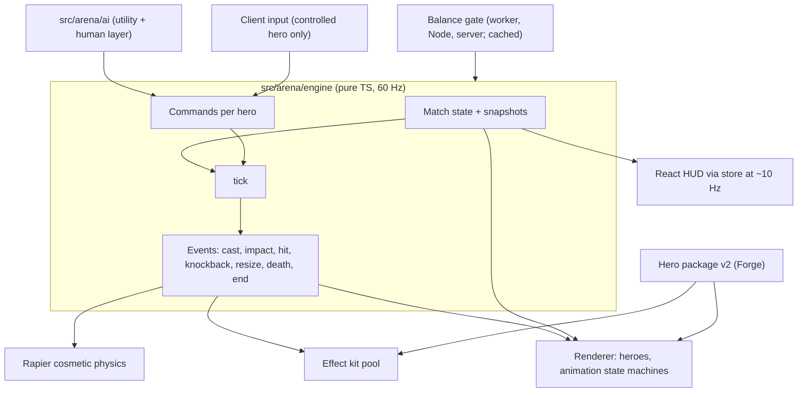
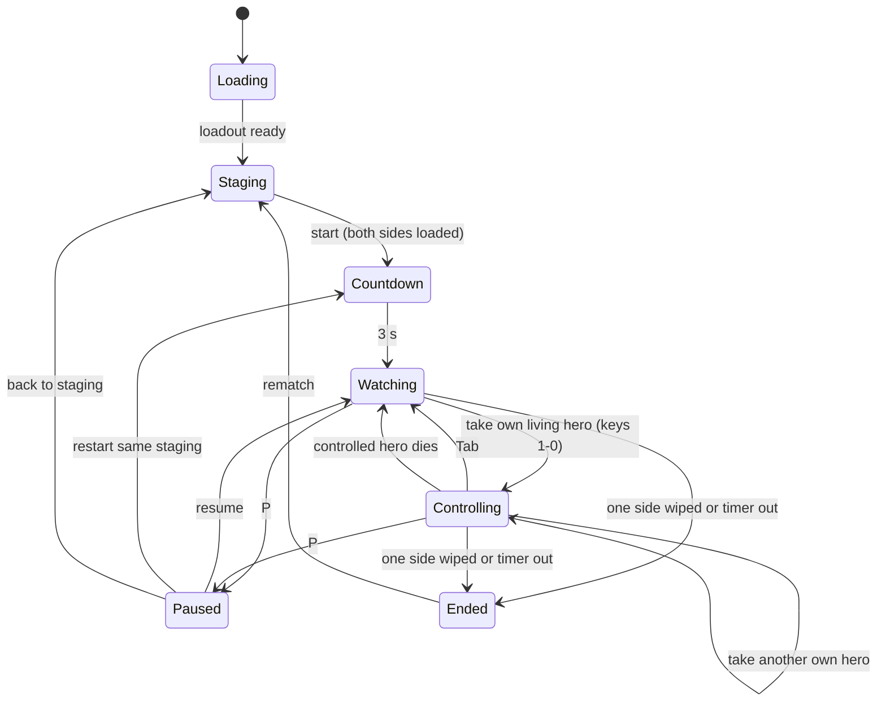

# 3D Arena - Plan

## Goal Capsule

- **Objective:** A streamer opens the game in a browser, stages a fight between two hero armies they picked, and gets a match that looks and plays like an anime arena brawler: AI fighting on its own, and the option to jump into any of their heroes and win or lose it live in front of chat.
- **Product authority:** The owner. This plan owns the core match and staged scenarios, plus the Charter and Forge changes the match needs (R28-R36, R43-R45). The Character Charter (`docs/plans/2026-10-22-1113-feat-character-charter-plan.md`, PR #1) and the Hero Forge (`docs/plans/2026-10-22-1717-feat-hero-forge-plan.md`, PR #2) stay as written; this plan states its changes to them and does not edit them. Campaign, 1v1 online, the local 10v10 mode and the cinematic camera are not active scope. Product Contract wins on behavior; Planning Contract KTDs win on mechanism.
- **Means:** One deterministic rules engine runs the live match and the balance gate, with rendering, effects and physics on top for spectacle (KTD1).
- **Open blockers:** None.
- **Stop conditions:** Stop and report in any of these cases:
  - The U1 spike cannot hold 60 fps with 20 heroes, effects and simulated game load on an M1 in Chrome or Safari.
  - `npm run sim` cannot be brought back under the 0.55 ceiling on the new engine.
  - The gate cannot meet its time budget (KTD6).
  - A settled decision proves unworkable.
  - Any step needs a paid live provider call. None are allowed while building, and no keys exist.
- **Execution profile:** Deep. 18 units in five phases: spikes, engine, AI, Charter and Forge changes, then the game client.
- **Tail ownership:** The executor commits per unit on `feat/3d-arena-plan`, stacked on `feat/hero-forge-plan` (PR #2). Review, PR and CI belong to the pipeline that runs the plan.

**Target repo:** `psyblr-autobattler`. Builds on the Charter and Forge code on this branch.

**Product Contract preservation:** changed:
- R19 is deferred, R17 drops "baits out cooldowns", and the AI success criterion softens to "at a glance". All three follow the owner's direction for a bare-minimum demo AI.
- R23, R29 and AE6 now use a sixth, transformation-only size class instead of continuous growth.
- R37-R45 are added from the owner's plan-review decisions: staging edits, the watching HUD, countdown and pause, loading states, volume, the hero camera, per-skill hit geometry, six size classes and blended forge pricing.

Outstanding Questions deferred to planning are resolved in place by KTDs.

---

## Product Contract

### Summary

A browser 3D arena where a streamer deploys up to 10 heroes a side into formation, then watches AI fight under a free camera, and can take over any of their own heroes with free aim at any moment.
v0 is judged on three things: hits that land hard, bodies that fly, and abilities that look like the fantasy, in a web-realistic style that holds 60 fps on an M1.
The build grows the balance sim into a 3D real-time engine, adds a demo-grade AI, extends the Charter and Forge, and puts a three.js client with staging, effects, physics and takeover on top.

### Problem Frame

The Charter made any hero fair and the Forge made any hero real, but nobody can watch them fight yet. The only combat today is a headless 2D model built for balance (`src/sim/engine.ts`).
Streamers who run "who would win" fights today pick between good combat graphics, easy hero-making, and auto-battle, and they never get all three. Nothing lets them stage a fight, sit back while it plays, and then grab one fighter and turn the battle around the way FIFA lets you switch players.
Two kinds of players want this. Some stage battles like TABS and enjoy the show. Others want to drop into a real 3D brawler and flex. One match has to serve both.

### Key Decisions

- **The core match and staged scenarios, together.** (session-settled: user-directed — chosen over the core match alone, core plus 1v1 online, and every mode at once: staging is how streamers use the match.)
- **Anime spectacle, not TABS physics.** Physics sells hits Sparking Zero-style but never decides the outcome. (session-settled: user-directed — chosen over physics moving heroes into range and physics deciding hits: fair fights with cinematic combat.) Governs R9, R10.
- **Every hero can fly, and `moveSpeed` is locomotion.** (session-settled: user-directed — chosen over ground fights with air bursts and flight for some heroes: flight speed, jump range and run speed all come from one stat.) Governs R8, R28.
- **Free aim.** (session-settled: user-directed — chosen over a Sparking Zero lock-on and a lock-on/free-aim hybrid: a higher skill ceiling to flex on stream.) Governs R14.
- **AI aims like Overwatch 2's hardest bots, and taking control gives no edge.** (session-settled: user-directed — the risk that near-perfect AI makes takeover a downgrade was surfaced; the edge comes only from the player's aim and timing.) Governs R16, R18.
- **A bare-minimum opponent AI for the demo.** (session-settled: user-directed — chosen over self-play tuning and machine learning: the demo needs no GPU training, and adaptation to player tricks waits.) Governs R17, R18.
- **1 to 10 heroes a side, uneven allowed.** (session-settled: user-approved — chosen over always-equal sides and always 10v10: one hero against ten is a stream moment.) Governs R7, R37.
- **Last side standing, with a long timer that counts heroes alive.** (session-settled: user-directed — chosen over most health left and sudden death at time out: the timer stops running and healing stalls.) Governs R12.
- **Honest hit areas.** (session-settled: user-approved — chosen over honest attacks with free-size cosmetics, and pure spectacle: free aim stays fair and readable.) Governs R11, R23.
- **Six size classes, with the sixth reachable only by transforming.** A transformation moves a hero up or down the ladder for its duration. (session-settled: user-directed — chosen over a continuous growth effect: a size-1 hero can become size 3, 4 or 6, and nothing grows past the sixth class.) Governs R23, R29, R44.
- **Each skill carries its own hit geometry, priced by the budget.** (session-settled: user-directed — chosen over shared constants per delivery type: more variety, priced so it stays fair.) Governs R43.
- **One blended forging price per hero, at twice provider cost.** (session-settled: user-directed — chosen over repricing only the motion stage and absorbing the extra calls.) Governs R45.
- **Free camera in v0; the cinematic director comes later.** (session-settled: user-directed — chosen over the cinematic POV first: v0 polish goes into hits, motion and effects.) Governs R13.
- **An effect kit, plus one generated form mesh per hero.** (session-settled: user-approved — chosen over kit-only and per-hero generated effects: cheap and consistent, with a real fox titan where it counts.) Governs R21, R22, R33, R34.
- **Web-realistic heroes: realism in textures, not geometry.** (session-settled: user-directed — chosen over full-detail hyper-real meshes and a stylised pass in the arena: keeps the Forge's realistic likeness at browser speed.) Governs R24, R35.
- **This plan owns the Charter and Forge changes the Arena needs.** (session-settled: user-directed — chosen over listing them as prerequisites for separate amendments.) Governs R28-R36, R43-R45.
- **One rules engine for the live match and the balance gate.** The gate then measures what people play, and a later 1v1 online mode can replay the same engine. A separate arena game would let the gate and the live match drift apart. Governs R9, R30, R31.

### Actors

- A1. **Streamer:** sets up both sides, watches, and takes control of heroes on their side. Usually live on Twitch or YouTube.
- A2. **Audience:** watches the stream. Never touches the game in v0.
- A3. **Battle AI:** plays every hero nobody is controlling, on both sides.

### Requirements

**Arena and staging**

- R1. The arena is one map split into two near-mirror halves with small differences, like Dire and Radiant, with no lanes, creeps, towers or base to destroy.
- R2. The streamer picks a side, then drags heroes from the global loadout onto their half and places them in formation.
- R3. The bottom HUD shows the loadout as a row of 3D busts, each with the hero's name and primary symbol.
- R4. The left HUD shows the primary synergies, and each one lights up once the deployed army meets it under the Charter's army rules (Charter R16).
- R5. Holding or selecting a hero shows its details and tooltips in the right HUD.
- R6. The streamer sets up the enemy half the same way, and an auto-deploy option fills either half.
- R7. Each side holds 1 to 10 heroes, and the two sides may differ in size.
- R37. A placed hero can be dragged to a new spot, or dragged off the field (or removed with Delete) to return it to the row. The same hero can be placed more than once, up to 10 a side.

**The fight**

- R8. Heroes fight in full 3D, and every hero can fly. `moveSpeed` sets ground speed, flight speed and jump range together (R28).
- R9. The rules engine decides every hit, every amount of damage, every control effect and the winner. Physics shows impacts, knockback flight, ragdolls and debris without changing any outcome.
- R10. Hits land hard. Every hit shows impact effects such as blood and aura flashes, heavy melee hits launch the target, and big blasts throw bodies around.
- R11. The damaging part of every effect looks exactly as big as its real hit area, and glow beyond that edge reads as harmless.
- R12. A match ends when one side has no heroes standing. A long timer stops stalling: when it runs out, the side with more heroes alive wins, and the larger share of remaining health breaks a tie.
- R39. A fight starts after a 3-second countdown. P pauses it, with resume, restart from the same staging, and back to staging; the fight freezes while paused.

**Watching and control**

- R13. At match start every hero is AI-controlled, and the streamer flies a free camera around the arena.
- R14. The streamer can take control of any living hero on their own side at any time, with third-person movement, flight and free aim for the basic attack, both actives and the ultimate.
- R15. When the controlled hero dies, the view returns to the free camera until the streamer takes another hero.
- R16. A controlled hero gets no stat, rule or aim assist that the AI version lacks.
- R38. During a fight the HUD shows:
  - A match timer.
  - A roster strip of the streamer's heroes, numbered 1-0 in formation order. Each hero shows its two actives and its ultimate with cooldowns, and dead heroes are greyed out.
  - Team-coloured markers over heroes in the world.
  - Synergies in the left panel.
  - A right panel the streamer can toggle, showing each hero's stats such as DPS and health.
- R42. A controlled hero is seen over the shoulder, with the aiming reticle at screen centre. The view blends smoothly, never snapping, when the streamer takes a hero, hands it back, or the hero dies.

**Battle AI**

- R17. The AI fights like a seasoned human team: it dodges, spaces, jukes in flight, focuses the right target and times ultimates. It never looks like a fixed if/else routine.
- R18. AI aim matches Overwatch 2's hardest bots: strong and human-like, but beatable.
- R20. A hero the streamer switches away from carries on under the AI without a visible hitch (Charter R17).

**Effects and look**

- R21. Each skill's visual is built from a composable effect kit: charged orbs, beams, shockwaves, trails, cloaks and auras, ground cracks, sky changes and spirit forms, tinted and scaled per skill.
- R22. A hero may carry one generated form mesh for its transformation or spirit form. The form may be non-humanoid; the hero stays humanoid.
- R23. A transformation moves the hero to another size class for its duration, up or down. Its hitbox, reach and form mesh all match that class (R44).
- R24. Arena heroes use the web-realistic look. Proportions are realistic, the body is a smooth mesh of 5,000 to 8,000 triangles, and surface detail comes from roughness and baked ambient-occlusion textures. Textures are at most 2K for the heroes in focus and 1K for the rest, GPU-compressed, with standard PBR materials.
- R25. The arena environment and effects follow a minimal style that protects the frame rate.

**Platform**

- R26. A 10v10 staged match with every effect in play holds 60 fps on an M1 MacBook in current Chrome and Safari.
- R27. The game runs in the browser with no install, and a streamer can capture it with normal streaming software.
- R40. The streamer always sees what is happening:
  - Start waits, behind a loading overlay with progress, until both sides are ready.
  - A hero that fails to load fights as a mannequin, with a small notice.
  - An empty loadout links to the Creator.
  - A browser that can't run the game shows a clear message.
- R41. A volume control and a mute toggle are always reachable.

**Charter changes**

- R28. `moveSpeed` becomes locomotion, covering ground speed, flight speed and jump range, and hero tooltips say so.
- R29. A transformation's size change is priced in the stat budget the way size classes are.
- R30. The balance gate runs on the same rules engine as the live match, with flight, 3D hit checks, formations and AI aim accuracy modelled. Every stored build is re-gated against the new engine.
- R31. The new battle AI (R17, R18) replaces the hint-priority chooser. Template usage hints stay as inputs to it.
- R43. Every skill carries its own hit geometry where its delivery needs it: projectile speed and size, melee and cone arc angle, and beam width. The stat budget prices these values, and tooltips show them.
- R44. There are six size classes. Players choose from the first five. The sixth, the largest, is reachable only by a transformation.

**Forge changes**

- R32. The motion library gives every hero flight motions, including take-off, hover, flying, air dash and landing, on any humanoid rig.
- R33. The cultural director writes an effect-kit recipe for each skill and the passive, built from the player's fantasy and sized to the skill's true hit area (R11).
- R34. The Forge can generate one form mesh per hero for its transformation or spirit form, as a confirm-before-pay stage like the others.
- R35. The Forge produces an arena-ready hero to R24 next to its existing archival assets, automatically for every forged hero.
- R36. Hero package v2 carries the effect recipes, the form mesh and the arena-ready hero. A v1 hero still loads, with default recipes for each delivery type and no form mesh.
- R45. A full hero forge costs one blended credit price, set at twice the estimated provider cost of every generation it includes, and that price includes the arena hero and the optional form. Stage-by-stage charging still applies on each confirm.

### Key Flows

- F1. Stage a match
  - **Trigger:** The streamer opens the arena.
  - **Actors:** A1
  - **Steps:** Wait for the loadout to load; pick a side; drag heroes from the loadout row into formation, moving or removing them as needed, while the synergy panel lights up and details show on the right; set up the enemy half by hand or with auto-deploy; start the fight once loading finishes.
  - **Outcome:** Two armies of 1 to 10 heroes each stand in formation on their halves, and a 3-second countdown begins.
  - **Covered by:** R1-R7, R37, R39, R40
- F2. Watch, take over, hand back
  - **Trigger:** The countdown ends.
  - **Actors:** A1, A3
  - **Steps:** All heroes fight under the AI while the streamer flies the camera and reads the HUD; the streamer spots trouble and takes control of one of their heroes by its number; they fight it over the shoulder with free aim and flight; they hand it back, or it dies and the view returns to the free camera; they may take another hero or pause.
  - **Outcome:** The streamer swings the fight, or loses it, by their own skill.
  - **Covered by:** R13-R18, R20, R38, R39, R42
- F3. Match end
  - **Trigger:** One side is wiped out, or the timer runs out.
  - **Actors:** A1, A2
  - **Steps:** The engine declares the winner by R12, and the arena shows the result.
  - **Covered by:** R12

### Acceptance Examples

- AE1. **Covers R14, R15.** Given the streamer controls a hero that then dies, when its health hits zero, then the view returns to the free camera and every other hero keeps fighting under the AI.
- AE2. **Covers R14.** Given the streamer picked the left side, when they try to take control of a right-side hero, then nothing happens.
- AE3. **Covers R12.** Given the timer runs out with 3 heroes alive on the left and 2 on the right, then the left side wins even if the right side has more total health left.
- AE4. **Covers R12.** Given the timer runs out with 2 heroes alive on each side, then the side with the larger share of its starting health still standing wins.
- AE5. **Covers R7.** Given one hero on the left and ten on the right, when the streamer starts the fight, then the match runs with no sizing error or warning.
- AE6. **Covers R11, R23, R44.** Given a size-1 hero transforms into a sixth-class fox titan, then for the transformation's duration its hitbox, reach and form mesh all match the sixth class. A shot that visibly hits the titan's body counts as a hit, and the hero returns to size 1 afterwards.
- AE7. **Covers R36.** Given a hero forged before package v2, when it enters the arena, then it fights with default effects for each delivery type and no form mesh, and no asset is missing.
- AE8. **Covers R9.** Given the same two armies and the same seed with no human input, when the match runs twice, then the same side wins both times with the same survivors.
- AE9. **Covers R39.** Given a paused fight, when the streamer resumes, then every hero, projectile and timer continues exactly where it stopped.
- AE10. **Covers R44.** Given the Creator, when a player picks a size class, then only the first five classes are offered.

### Success Criteria

- **The AI passes for human at a glance.** Viewers watching a clip can't easily tell which hero the streamer is driving.
- **The fantasy reads.** A streamer forges a Spirit Bomb hero and a Levi Ackerman with a Nine-Tails cloak and a fox titan form, and chat names both without being told.
- **The demo test.** It's the most creative hero freedom on offer, it plays like a well-built 3D arena fighter, and it's easy to run and stream from a browser.

<!-- ce-section: work-relationships -->
### How This Work Fits Together

This plan owns the core match, staged scenarios, and the Charter and Forge changes they need. The breakdown below is the current understanding, not a committed roadmap.

- The Character Charter (`docs/plans/2026-10-22-1113-feat-character-charter-plan.md`, PR #1)
  - Enables this plan with kits, stats, army synergy, tooltips and AI usage hints.
  - This plan changes it through R28-R31, R43 and R44.
- The Hero Forge (`docs/plans/2026-10-22-1717-feat-hero-forge-plan.md`, PR #2)
  - Enables this plan with hero packages, rigs and the motion library.
  - This plan changes it through R32-R36 and R45.
- The cinematic camera director
  - Depends on this plan's match. The one rules engine can run a fight ahead of playback, which gives the director advance knowledge of the big moments.
- Campaign (a 10-hero army in a "tournament of power"), local 10v10 and 1v1 online armies
  - Depend on this plan's match.
  - 1v1 online also depends on the engine's determinism and snapshots (KTD1) for lockstep or rollback play, and on the server-side gate re-run the Charter deferred.
- Chat integrations such as viewer votes and predictions
  - Depend on staged scenarios. Still to decide.

### Scope Boundaries

**Deferred for later**

- The cinematic camera director.
- Campaign, local 10v10 and 1v1 online modes.
- Chat integrations.
- More than one arena map.
- In-match growth: levels, items, shops (already deferred by the Charter).
- Hero voice lines (already deferred by the Forge).
- Gamepad play.
- AI that adapts to a human-controlled enemy, so repeating the same movement trick stops working (formerly R19). Deferred for the demo by the owner.
- Self-play tuning or machine-learned AI.
- A rule for heroes a player paid for that fail the re-gate on the new engine. Until then they keep the existing gate behaviour: retuned or blocked.

**Outside this product's identity**

- MOBA structure: lanes, creeps, towers, bases.
- Physics-decided outcomes in the TABS style.

#### Deferred to Follow-Up Work

- A Blender bake service for normal and ambient-occlusion maps, if Tripo's low-poly output loses likeness (KTD10).
- Cross-browser determinism checks in CI. This plan checks Node against Chrome, and the owner checks Safari by hand.
- Moving physics to a worker, if profiling shows Rapier above about 2 ms per frame (KTD12).

### Dependencies / Assumptions

- Streamers want all three of combat graphics, easy hero-making, and auto-battle with takeover. This is the owner's read of the market; no named streamer or test audience backs it yet, so first-stream feedback is the check.
- The streamer plays with keyboard and mouse.
- Stylised blood is acceptable on Twitch and YouTube at the intended intensity.
- A Tripo hero requested at about 8,000 faces with PBR textures keeps the likeness the Forge confirmed. Unverified until keys exist.
- Tripo, or another Forge provider, can produce a non-humanoid form mesh such as a fox titan. Unverified until keys exist.
- v0 has basic impact and ability sounds so hits land. Per-hero sound design stays deferred.
- No GPU quota is known to this work, so nothing in the plan trains a model.
- The 20 demo heroes (U1) parody public figures, which the Forge's likeness decision allows.

### Outstanding Questions

**Resolve Before Planning**

- None.

**Deferred to Implementation**

- Exact key bindings beyond the defaults in KTD16, after the first playtest.
- Final timer length, arena size and AI constants, tuned in U7 and U18 playtests.
- Provider cost estimates behind the blended price (KTD18), refreshed once live costs are measured.

### Sources / Research

- `docs/plans/2026-10-22-1113-feat-character-charter-plan.md`: R1 kit shape, R15 gate ceiling, R16 army rules, R17 AI usage hints, KTD6 abstract model and the re-calibration risk.
- `docs/plans/2026-10-22-1717-feat-hero-forge-plan.md`: R14 size classes, R16 motion library, R21-R22 hero package, KTD8 sizes, KTD9 package, and the Tripo limits (11 presets, up to 150k faces).
- Reference games named by the owner: Dragon Ball Sparking! Zero (feel, flight), Deadlock (depth, range of motion), Overwatch 2 (hardest-bot AI bar), EA FC/FIFA (player switching), TABS (staging). Performance bar: doodleshooter.vercel.app.

---

## Planning Contract

### Key Technical Decisions

- KTD1. **One deterministic engine in `src/arena/engine/`, run live and headless.** Pure TypeScript with no DOM, timer or three.js imports, so the same code runs in the browser, a Web Worker and Node.
  - It ticks at a fixed 60 Hz.
  - State is flat plain data that can be snapshotted, restored and hashed every tick.
  - It draws from two seeded RNG streams, one for rules and one for the AI.
  - The engine and the AI (`src/arena/ai/`) never call a `Math` function that browsers may compute differently: `sin`, `cos`, `tan`, `atan2`, `asin`, `acos`, `pow`, `exp`, `log`, `cbrt` and `hypot`, nor the `**` operator. They use the polynomial approximations in one maths module instead. Distances are `Math.sqrt` of summed squares; `+ - * /` and `Math.sqrt` are exact everywhere.
  - Iteration order is fixed (arrays, not object-keyed maps).
  - It replaces the 2D model in `src/sim/engine.ts`. `src/sim` keeps its public entry points (`simulate`, `duel`, `runGate`, `winRateVsField`) as thin wrappers over the new engine, so the Creator, the server, the Forge's size pricing and `npm run sim` keep working.

  Governs R9, R30. (session-settled: user-approved — chosen over Node-only determinism for v0: cross-browser replay now avoids an engine rewrite for 1v1 online.)
- KTD2. **Space and locomotion.** Positions are 3D with y up, inside a bounded arena with a floor and a ceiling. Each hero is grounded or airborne. Ground speed is `moveSpeed`; flight speed and jump or air-dash reach are fixed multiples of it, kept in the calibration file. Gravity applies only while grounded movement is chosen; flying heroes hold altitude. Governs R8, R28.
- KTD3. **Hits are engine geometry, and visuals read the same numbers.**
  - Every hero is a vertical capsule whose radius is a base radius plus its current size class's `hitRadius` (KTD14).
  - Each template's delivery carries its own geometry: `range`, `radius`, and, where the kind needs them, `speed` and `projectileRadius` for projectiles, `arcDegrees` for melee and cones, and `width` for beams (R43).
  - Projectiles travel along an aim direction and are swept between ticks, so they hit the first capsule along their path and fast shots cannot skip through a hero.
  - Beams are capsule-shaped segments. Melee and cones are 3D arcs. Zones and auras are spheres or ground discs. `self` deliveries affect only the caster.
  - The effect renderer sizes every damaging core from the same values, so R11 holds by construction.
  - Displacements (knockback, pulls) are engine-computed trajectories over several ticks, not physics.

  Governs R9, R11, R43.
- KTD4. **One command per hero per tick.** A command holds a move vector, up or down, aim yaw and pitch (quantized), and button presses for each slot. The AI writes commands for every hero nobody controls. The client writes them for the controlled hero, and only for a hero on the streamer's side. A match replays exactly from seed plus roster plus command log. Governs R14, R16, R20, AE2, AE8.
- KTD5. **Match rules live in the engine, with two settings profiles.**
  - **Live profile:** formation positions come from staging, with a default formation when none is given. The timer defaults to 300 seconds. At time out the winner is chosen by R12, and a draw remains only on an exact tie in heroes alive and health share. There is no damage ramp. The engine supports pause and resume (R39).
  - **Gate profile:** the same rules with a 60-second cap and the existing overtime damage ramp from 40 seconds, so every balance duel ends quickly (KTD6).

  Both profiles live in calibration. Governs R7, R12, R39, AE3-AE5, AE9.
- KTD6. **The balance gate moves to the new engine, with a time budget.**
  - `runGate` runs headless engine duels with AI on both sides under the gate profile (KTD5). It runs in five places: the existing browser Web Worker, Node for `npm run sim`, the server on hero create and save (`src/server/store.ts`), the server on forge publish (`src/server/forge-publish.ts`), and size pricing (`src/forge/sizes.ts`).
  - **Budget:** a passing gate run stays under 2 seconds in Node on the dev machine. The worst case, a blocked build after every retune, stays under 30 seconds. U6 measures both.
  - **Cache:** the gate result is a pure function of the build's numbers plus the catalogue and calibration versions, because the engine is deterministic. The server caches results under that key and skips the run on a cache hit, so cosmetic edits and repeat saves cost nothing.
  - **Staleness:** the gate stamp includes `CALIBRATION_VERSION` and `AI_CALIBRATION_VERSION`. Changing either the engine or the AI calibration marks every stored build stale. Starting values: calibration 3, AI calibration 1.
  - The 0.55 ceiling, its margin and the field stay. Size-class health and speed multipliers are re-tuned so each choosable class averages about 50% against the field, and re-tuned again after the final AI tuning.

  Governs R30.
- KTD7. **Demo AI: utility scoring plus a thin human layer.**
  - Each AI hero re-decides every 9 ticks (150 ms), not every tick.
  - It scores a small action set: approach, hold range, strafe, dodge, retreat, and cast a slot. Template usage hints feed those scores as priors.
  - The human layer adds a reaction delay of 9 to 15 ticks (150-250 ms), aim that tracks the target with lag, overshoot and correction instead of snapping, a dodge when it sees a projectile heading its way, and team focus on the enemy with the lowest effective health in reach.
  - All timings are in ticks. All maths goes through the engine maths module (KTD1).
  - All constants sit in one versioned AI calibration file (KTD6) and are tuned by hand in playtests. There is no learning, no self-play harness and no adaptation to player tricks.

  Governs R17, R18, R31. (session-settled: user-directed — chosen over self-play tuning and machine learning: bare minimum for the demo with no GPU training.)
- KTD8. **Renderer: three.js `WebGPURenderer`, with its automatic WebGL2 fallback.** Custom materials are written in TSL node materials so they compile on both backends. No compute shaders are used, because the fallback lacks them, so particles animate in vertex shaders. Rendering sits behind a thin boundary in `src/arena/client/render/`, so a backend change touches one module. Safari is tested first, because it has been the least stable backend. (session-settled: user-approved — chosen over plain WebGLRenderer for v1: keeps the WebGPU target while the fallback covers every browser.) Governs R26, R27.
- KTD9. **Hero rendering stays cheap without LOD.** Heroes of the same build share geometry and materials through skeleton cloning. Each hero has one material. Only heroes near the camera cast shadows. Heroes far from the camera update their animation every second to fourth frame. An animation state machine per hero (idle, run, fly, cast per slot, hit, stunned, dead) is driven only by engine events. The engine's previous and current states are interpolated for rendering.
- KTD10. **Arena heroes come from a second, low-poly Tripo call, processed inside Vercel.**
  - After the confirmed body exists, the Forge requests an arena mesh at about 8,000 faces with PBR textures, rigs it on the Mixamo skeleton and retargets the motion set onto it.
  - A server step in the function then packs roughness and AO, caps textures at 2K, adds a 1K variant and meshopt-compresses the geometry.
  - Textures are encoded to KTX2 with a WebAssembly Basis Universal encoder, because the native KTX tool does not exist in Vercel functions. If that does not fit the function's memory or time limits, textures ship as WebP instead.
  - Every forged hero gets its arena version automatically; there is no offline step.
  - The archival quad mesh stays as it is. A Blender bake service is the fallback if the likeness suffers, and is not built now.

  (session-settled: user-approved — chosen over a Blender bake server: no new infrastructure outside Vercel.) Governs R24, R35.
- KTD11. **The effect kit is data: a versioned recipe per skill.**
  - A recipe lists timed phases (charge, travel, impact, linger). Each phase holds primitives: orb, beam, shockwave ring, trail, cone sweep, aura shell, ground-crack decal, sky tint, spirit form. Each recipe has a palette and an intensity.
  - Primitive sizes are stated relative to the skill's delivery geometry, never in absolute metres, so a recipe cannot misstate a hit area (R11).
  - Every delivery kind has a default recipe.
  - The renderer is an in-house pool of instanced meshes, with particle motion computed in the vertex shader from start time and seed, so there is no per-particle CPU work and no per-frame allocation. The budget is under 100 effect draw calls and about 50,000 live particles.
  - Hit feel adds stylised blood, aura flashes, a 50-80 ms render-only hit-stop and camera shake, all cosmetic. The engine keeps ticking during hit-stop, and the next frame catches up through interpolation.

  Governs R10, R21, R25, R33.
- KTD12. **Physics is cosmetic Rapier on the main thread.** It uses `@dimforge/rapier3d-compat`. It runs ragdolls on death, debris from heavy hits, and ragdoll flight that follows each engine knockback trajectory and blends back to the engine's end pose over a few frames. The engine never reads physics. Active bodies are capped and sleep aggressively. Governs R9, R10.
- KTD13. **Hero package v2 and a v1 upgrade on load.** v2 adds an arena-hero asset, a recipe on each slot effect and on the passive, and an optional form (mesh, which slot triggers it, and its target size class). The loader accepts versions 1 and 2. It upgrades v1 in memory with default recipes per delivery kind and no form, and points the arena at the v1 rigged model. `validatePackage` checks each version against its own rules. Governs R36, AE7.
- KTD14. **Transformations change size class through a `resize` effect.**
  - The Charter has six size classes. The five existing ones are choosable. A new sixth class, `colossal`, sits above `huge` and is reachable only through `resize`.
  - A `resize` effect sets the hero's size class to a target class for a duration, up or down. While active, the engine uses that class's hitbox, reach, health and speed multipliers, then restores the chosen class.
  - The budget prices `resize` from the size-class profile difference, the same way the Forge prices size choices, and the gate measures its real effect.
  - Transform templates (tags `transform` or `form`, such as `fighter-super-form` and `tank-titan-form`) gain a `resize` effect.
  - The form mesh is scaled to the target class, so what the audience sees matches the hitbox.

  Governs R23, R29, R44, AE6, AE10.
- KTD15. **The game loop lives outside React.** The Arena is a lazy-loaded tab in `src/ui/App.tsx`. Staging and HUD are React in `src/ui/arena/`. The loop, renderer, input, effects and physics are plain TypeScript in `src/arena/client/`. React reads match state through a small store at about 10 Hz, never every frame.
- KTD16. **Controls and cameras.** Pointer lock starts from a click.
  - **While controlling a hero:**
    - WASD moves, Space flies up, Z flies down and Shift fires the movement skill.
    - The mouse aims. Left click is the basic attack, Q and E are the actives and R is the ultimate.
    - Keys 1-0 take control of the matching hero on the streamer's side, in formation order (R38).
    - Tab hands control back to the AI and keeps the pointer locked.
  - **Escape** releases the pointer and shows an overlay with "Resume" and "Leave match". Chrome refuses a new lock for about 1.25 s after Escape, so the overlay waits for a click.
  - **P** pauses (R39). No binding uses Ctrl or Alt, because browsers reserve those combinations.
  - **Free camera:** flies with WASD and the mouse.
  - **Hero camera:** over the shoulder, behind and right of the hero, with the reticle at screen centre and aim taken from the camera ray. Pitch is limited short of vertical. Both cameras are pulled in by a ray against simple arena proxies. Switching between them blends over about half a second.
  - `unadjustedMovement` is requested where supported.

  Governs R13-R15, R38, R39, R42.
- KTD17. **Heroes for staging come from the existing loadout APIs.** The arena reads the existing `GET /api/heroes/search` and `GET /api/heroes/package` endpoints. With no keys or fake providers, heroes render as the procedural mannequin with default recipes, so the arena runs offline and in tests. Governs R2, R3.
- KTD18. **Forge pricing derives from one blended per-hero cost.** `src/forge/pricing.ts` holds an estimated provider cost for every generation in a full forge: concept images, archival mesh, arena mesh, rigs, retargets, effect images and the optional form, weighted by its expected take-up. The blended hero price is twice that total. Stage prices are that price split across the paid stages in proportion to their cost, so per-stage charging on confirm is unchanged, and `FREE_GRANT` follows from them as today. Governs R45.

### High-Level Technical Design

The engine is the only source of truth; everything else reads its events and state.



Each frame, the client runs as many fixed ticks as wall time allows, then renders between the last two states.

```mermaid
sequenceDiagram
  participant Loop as Client loop (rAF)
  participant In as Input
  participant Eng as Engine
  participant Ren as Renderer + effects + physics
  Loop->>In: sample controlled-hero command
  loop while accumulator >= 1/60 s and not paused
    Loop->>Eng: tick(commands from AI + input)
    Eng-->>Loop: events
  end
  Loop->>Ren: apply events, interpolate states by remainder
  Ren-->>Loop: frame drawn
```

The match moves through these states.



### Output Structure

```text
src/arena/
  engine/      state, maths, rng, tick, locomotion, snapshot, calibration, deliveries, effects, events, match
  ai/          brain, aim, calibration
  client/      loop, store, heroes, animation, map, bench, render/, effects/, physics, ragdoll, input, camera, takeover, quality, audio
  recipes/     schema, defaults, validate
src/ui/arena/  ArenaScreen, BenchScreen, staging/, MatchHud, ControlHud, PauseMenu, Result
```

### Sequencing

1. Spikes: U1 and U2. U1's result can stop the plan (Goal Capsule stop conditions).
2. Charter first, then engine: U8, then U3, U4 and U5. U8 can start alongside U3, but must land before U4's verification.
3. AI, then the gate: U7, then U6. U6 needs U7's AI and U8's catalogue.
4. Forge: U9, U10, U11, U12.
5. Client: U13, then U14, U15, U16 and U17 in any order, then U18.

### Risks

| Risk | Mitigation |
|---|---|
| Safari's WebGPU backend misrenders or stutters | U1 tests Safari first. The renderer boundary (KTD8) allows forcing the WebGL2 backend. |
| The new engine shifts balance, and stored heroes fail the gate | KTD6 re-tunes size multipliers, then re-gates. The stop condition covers a ceiling that cannot be met. |
| The gate is too slow for server saves | The gate profile, the cache and the time budget (KTD5, KTD6). The stop condition covers a missed budget. |
| Per-skill geometry widens the balance surface | The budget prices it (R43), and the gate measures each build. |
| Tripo's 8k mesh loses the confirmed likeness | Check one hero in U2 when keys exist. The Blender bake stays the documented fallback. |
| The WASM texture encoder exceeds function limits | WebP fallback (KTD10). |
| Free aim on a trackpad feels poor | Keyboard and mouse are assumed. Gamepad is deferred. |
| The demo AI reads as robotic | The human layer (KTD7) and hand tuning in playtests. Adaptive AI is deferred by the owner. |
| `Math.*` differences break replays between browsers | KTD1's maths rule over engine and AI, a hash test in Node and Chrome, and a manual Safari check. |

### Assumptions

- No API keys exist, so every Forge change is built and tested against fake providers. Live calls are never made while building.
- The owner runs the M1 benchmarks in Chrome and Safari. Automated browser checks use browser-use on the test Chrome at port 9335 (owner rule), never Claude-in-Chrome.
- The Charter and Forge PRs merge before or with this branch. This plan does not rebase them.

### Sources / Research

- `src/sim/engine.ts`: `Unit`, `createBattle`, the instant-hit `act`, `enemiesHit`, `step` with seeded move order, `simulate`, `duel`. It uses `Math.hypot` at line 84, which KTD1 bans. Effects and statuses port from here into U4.
- `src/sim/ai.ts`: `chooseTarget`, `preferredDistance`, the `wants` switch over `AiHint.use`. U7 replaces it.
- `src/sim/gate.ts`, `src/sim/calibration.ts`, `src/sim/gate.worker.ts`: the ceiling, version stamps and worker protocol U6 keeps. `src/server/store.ts` (`gated` on create and save), `src/server/forge-publish.ts:18` and `src/forge/sizes.ts` call `runGate` synchronously.
- `src/charter/types.ts`: `Delivery` (kind, range, radius), the `Effect` union (U8 adds `resize`), `AiHint`, and `Template.animationHook`.
- `src/charter/sizes.ts`: five classes, `tiny` to `huge`, with hitbox, reach, health and speed values. U8 adds `colossal`.
- `src/charter/synergy.ts`: `describeSynergy` for the left HUD.
- `src/charter/templates/fighter.ts` and `tank.ts`: `fighter-super-form` and `tank-titan-form` carry the `transform` tag.
- `src/forge/package.ts`: `buildPackage`, `validatePackage`, `effectShape`. `src/forge/stages.ts`: `STAGE_ORDER`, `STAGE_TABLE`, `EFFECT_SLOT`. `src/forge/pricing.ts`: `STAGE_PRICES`, `FREE_GRANT`. `src/server/forge-runner.ts`: effect requests per stage.
- `src/forge/providers/live/tripo.ts:58`: the mesh call already passes `face_limit`, `texture` and `pbr`.
- `src/forge/motion/library.ts`: `TRIPO_PRESETS` has no flight motion; unlicensed clips fall back to presets.
- `src/ui/forge/HeroViewer.tsx` and `viewer.ts`: GLB loading, `AnimationMixer`, the mannequin fallback and effect cast windows to reuse.
- three.js WebGPURenderer and its WebGL2 fallback: https://threejs.org/manual/en/webgpurenderer. Safari 26 ships WebGPU: https://webkit.org/blog/16993/news-from-wwdc25-web-technology-coming-this-fall-in-safari-26-beta/
- Rapier determinism and builds: https://rapier.rs/docs/user_guides/rust/determinism/
- gltf-transform CLI (`simplify`, `meshopt`, `uastc`, `etc1s`; no bake command; KTX commands need the native KTX tool): https://gltf-transform.dev/cli
- Pointer lock cooldown and `unadjustedMovement`: https://web.dev/articles/disable-mouse-acceleration

---

## Implementation Units

| U-ID | Title | Key files | Depends on |
|---|---|---|---|
| U1 | Performance spike | `src/arena/client/bench.ts`, `src/arena/demo/` | none |
| U2 | Arena-hero pipeline spike | `src/forge/arena-asset.ts` | none |
| U3 | Engine core | `src/arena/engine/state.ts`, `maths.ts`, `tick.ts` | none |
| U4 | Deliveries, hits and statuses in 3D | `src/arena/engine/deliveries.ts`, `effects.ts` | U3, U8 |
| U5 | Match setup and rules | `src/arena/engine/match.ts` | U3, U4 |
| U6 | Gate and sim on the new engine | `src/sim/*`, `src/server/store.ts` | U5, U7, U8 |
| U7 | Demo AI | `src/arena/ai/*` | U4 |
| U8 | Charter: locomotion, sizes and hit geometry | `src/charter/types.ts`, `sizes.ts`, `budget.ts`, `tooltip.ts`, templates | none |
| U9 | Effect recipes | `src/arena/recipes/*`, `src/forge/director/schema.ts` | none |
| U10 | Flight motions | `src/forge/motion/library.ts` | none |
| U11 | Forge: arena hero, form stage and pricing | `src/forge/stages.ts`, `pricing.ts`, `src/server/forge-runner.ts` | U2, U9 |
| U12 | Hero package v2 | `src/forge/package.ts` | U9, U11 |
| U13 | Arena client core | `src/arena/client/loop.ts`, `render/*`, `src/ui/App.tsx` | U1, U5, U12 |
| U14 | Effect kit runtime and hit feel | `src/arena/client/effects/*` | U9, U13 |
| U15 | Cosmetic physics | `src/arena/client/physics.ts` | U13 |
| U16 | Staging UI | `src/ui/arena/staging/*` | U13 |
| U17 | Cameras, takeover and match HUD | `src/arena/client/input.ts`, `camera.ts`, `src/ui/arena/MatchHud.tsx` | U13, U7 |
| U18 | Pause, match end, audio and frame-rate guard | `src/ui/arena/PauseMenu.tsx`, `Result.tsx`, `src/arena/client/quality.ts` | U14-U17 |

### U1. Performance spike

**Goal:** Prove a 10v10 under realistic load holds 60 fps on an M1 in Chrome and Safari before the client is built, and seed a 20-hero demo roster.
**Requirements:** R26, R27; KTD8, KTD9, KTD11.
**Dependencies:** None.
**Files:** `src/arena/client/bench.ts`, `src/arena/client/render/renderer.ts`, `src/ui/arena/BenchScreen.tsx`, `src/arena/demo/roster.ts`, `src/arena/demo/README.md`, `src/arena/client/render/renderer.test.ts`, `src/arena/demo/roster.test.ts`, `package.json`.
**Approach:**
1. Add a `?bench` URL flag that opens a bare scene with no staging.
2. Build a 20-hero demo roster as Charter builds: 10 business moguls and 10 political leaders, each superhero- or anime-inspired, with their own names, roles, kits and size classes. They double as the staging demo loadout.
3. Give each its own body for the bench. Use CC0-licensed rigged humanoids (Mixamo bone names, under 8,000 triangles) with a distinct 2K texture set per hero, so no two heroes share geometry or textures. Record each asset's source and licence in `src/arena/demo/README.md`. Generated bodies replace them once keys exist.
4. Run the 20 heroes and flying on scripted paths, plus a stress loop of instanced particles (about 50,000 live) with additive blending.
5. Add synthetic main-thread load sized to the real budget: 60 engine ticks a second for 20 heroes, 20 AI decisions every 150 ms and about 2 ms of physics per frame.
6. Show an overlay with median and 1%-low frame time and the active backend (WebGPU or WebGL2).
7. Put renderer creation behind the `src/arena/client/render/` boundary, with a flag to force WebGL2.
**Execution note:** This is a measurement spike. Prefer a runtime check on the owner's M1 over unit coverage. Keep the bench, the renderer boundary and the demo roster; delete throwaway code.
**Patterns to follow:** `src/ui/forge/HeroViewer.tsx` for GLB loading; `src/sim/fixtures.ts` and `src/sim/field.ts` for builds.
**Test scenarios:**
- The renderer factory picks WebGL2 when WebGPU is unavailable (mocked `navigator.gpu` absent).
- The forced-WebGL2 flag wins even when WebGPU is available.
- The frame-time summary reports median and 1%-low correctly for a fixed list of frame times.
- Every demo roster build passes Charter validation and has a unique name, with 10 moguls and 10 leaders.
**Verification:** The owner sees a median frame time of 16.7 ms or less in Chrome and in Safari on an M1, with both backends tried in Chrome. If either browser fails, stop per the Goal Capsule.

### U2. Arena-hero pipeline spike

**Goal:** Turn a rigged hero GLB into an arena-ready GLB within the R24 budget, inside a Vercel function and testable without keys.
**Requirements:** R24, R35; KTD10.
**Dependencies:** None.
**Files:** `src/forge/arena-asset.ts`, `src/forge/arena-asset.test.ts`, `package.json`.
**Approach:**
1. Use gltf-transform as a library to weld, check the triangle count and meshopt-compress the geometry.
2. Pack roughness and AO into one texture, cap textures at 2K and add 1K variants.
3. Encode KTX2 with a WebAssembly Basis Universal encoder: UASTC for normals, ETC1S for the rest.
4. Measure memory and time for one hero. If they exceed the function limits, switch to WebP textures and record the switch in KTD10.
5. Report triangle count, texture sizes and output bytes.
**Execution note:** Spike first on a demo roster GLB from U1, or a test fixture. Live Tripo output is checked only when keys exist.
**Patterns to follow:** The provider fakes in `src/forge/providers/fakes/`.
**Test scenarios:**
- A fixture GLB under 8,000 triangles passes through with compressed geometry and 2K and 1K texture sets.
- A fixture above 8,000 triangles is reported as over budget, not silently accepted.
- A texture larger than 2K is downscaled to 2K and 1K.
- A GLB with no textures still produces a valid arena GLB with a flat material.
- With the WebP option set, output textures are WebP at 2K and 1K.
**Verification:** The function-style entry point produces an arena GLB that loads in the U1 bench at the reported size, within the function's limits.

### U3. Engine core

**Goal:** A pure, deterministic 60 Hz engine with 3D locomotion, commands, snapshots and a state hash.
**Requirements:** R8, R9, R28; KTD1, KTD2, KTD4.
**Dependencies:** None.
**Files:** `src/arena/engine/state.ts`, `src/arena/engine/maths.ts`, `src/arena/engine/rng.ts`, `src/arena/engine/tick.ts`, `src/arena/engine/locomotion.ts`, `src/arena/engine/snapshot.ts`, `src/arena/engine/calibration.ts`, `src/arena/engine/*.test.ts`.
**Approach:**
1. Define flat state: heroes with position, velocity, grounded or airborne, health, shields, statuses, cooldowns, chosen and current size class, and capsule radius.
2. Add the maths module with approximated trig and vector helpers. Distances use `Math.sqrt`.
3. Add a lint-style test that fails if any file under `src/arena/engine/` or `src/arena/ai/` uses a function or operator KTD1 bans.
4. Add two RNG streams (rules and AI), reusing mulberry32 from `src/sim/rng.ts`.
5. Add the tick: apply commands, move, clamp to arena bounds, advance cooldowns and statuses, and emit events. Add pause and resume.
6. Derive locomotion from `moveSpeed` per KTD2.
7. Add snapshot, restore and a 32-bit state hash.
**Patterns to follow:** `src/sim/engine.ts` (`Unit`, `prepare`, `createUnit`) and `src/sim/calibration.ts` (one versioned calibration file).
**Test scenarios:**
- A hero with move speed 6 covers 6 m on the ground in 60 ticks, flies at the flight multiple, and its jump reach scales with move speed.
- A hero cannot leave the arena bounds or go below the floor or above the ceiling.
- Snapshot, then 300 ticks, then restore, then 300 ticks gives the same hash both times.
- Two engines with the same seed and commands give the same hash at every tick for 3,600 ticks.
- The forbidden-maths check fails on a file under `src/arena/ai/` that calls `Math.hypot` or uses `**`.
- A stunned hero ignores its move command until the stun ends.
- Covers AE9. Pausing, then resuming, gives the same hash as a run that never paused.
**Verification:** The engine runs headless in Node under Vitest, with no DOM and no three.js in its import graph.

### U4. Deliveries, hits and statuses in 3D

**Goal:** Every Charter template works in 3D through engine geometry, with events the client can draw.
**Requirements:** R9, R11, R23, R43; KTD3, KTD14.
**Dependencies:** U3, U8.
**Files:** `src/arena/engine/deliveries.ts`, `src/arena/engine/effects.ts`, `src/arena/engine/events.ts`, `src/arena/engine/deliveries.test.ts`, `src/arena/engine/effects.test.ts`.
**Approach:**
1. Port damage, heal, shield, stun, slow, displace, mobility, buff and execute from `src/sim/engine.ts`, along with dots, hots, passives and diminishing heals. Keep their numbers. Replace `Math.hypot` with the maths module.
2. Apply `resize`: switch the hero's current size class for the duration, apply that class's hitbox, reach, health and speed, then restore the chosen class.
3. Resolve each delivery kind from its own geometry (R43) and the aim direction:
   - Melee and cones are arcs.
   - Projectiles are swept spheres that hit the first capsule along their path.
   - Beams are capsule segments.
   - Zones and auras are spheres.
   - `self` deliveries affect only the caster.
   - Dashes, blinks and grapples are movement with hit checks.
4. Compute displacement as a trajectory over ticks.
5. Emit events (cast start, projectile spawn, impact with its geometry, hit, knockback start and end, resize start and end, death), each carrying the delivery size.
**Patterns to follow:** `enemiesHit`, `applyTemplate`, `applyEffect`, `tickStatuses` in `src/sim/engine.ts`.
**Test scenarios:**
- A projectile aimed at a hero 20 m away hits after its own travel time, not instantly.
- A projectile fast enough to cross a capsule between two ticks still hits it.
- A projectile aimed 2 m wide of a medium hero misses, and the same shot hits a huge hero (larger capsule).
- A beam hits every enemy within its width along its segment, and none beyond its range.
- A cone with a 30-degree arc hits a hero at 10 degrees off-axis and misses one at 20 degrees.
- A zone with radius 4 hits a hero whose capsule edge is 3.9 m from the centre, and misses one at 4.1 m.
- Covers AE6. A size-1 hero hit by its own `resize` to `colossal` has the colossal capsule and reach for the duration, then returns to size 1.
- A knockback of 6 m moves the target 6 m over several ticks, and walls stop it.
- Each impact event carries the same geometry the hit check used.
- An airborne hero is hit by an aimed upward projectile and missed by a ground-disc zone.
**Verification:** Every template in the Charter catalogue can be cast in a headless test without errors.

### U5. Match setup and rules

**Goal:** Start a match from any two formations of 1-10 heroes and end it by R12, under the live or gate profile.
**Requirements:** R7, R12, R37, F3; KTD5.
**Dependencies:** U3, U4.
**Files:** `src/arena/engine/match.ts`, `src/arena/engine/match.test.ts`.
**Approach:**
1. Create a match from two rosters (duplicates allowed), optional formations, a seed and a profile. Apply army synergy with `describeSynergy` and the existing power scale.
2. Fall back to a default formation per side when none is given.
3. End the match on a wipe, or at the profile's timer by heroes alive, then health share.
4. Return a result with the winner, the reason (wipe or time-out) and per-hero stats, including damage dealt for DPS.
**Patterns to follow:** `createBattle` and `simulate` in `src/sim/engine.ts`; `armyModifiers` in `src/sim/cli.ts`.
**Test scenarios:**
- Covers AE5. A 1v10 match starts and runs to a result with no error.
- A roster with the same hero placed three times starts three independent heroes.
- Covers AE3. At time out with 3 alive against 2, the side with 3 wins even with less total health.
- Covers AE4. At time out with 2 against 2, the higher health share wins.
- Exactly equal heroes alive and health share at time out give a draw.
- A wipe ends the match before the timer, with reason "wipe".
- A staged formation places each hero at its staged position on its own half.
- Under the gate profile, a stalemated duel ends by 60 s through the damage ramp.
- Covers AE8. The same rosters and seed with no human commands give the same winner and survivors twice.
**Verification:** A 10v10 headless match completes in Node within the timer.

### U6. Gate and sim on the new engine

**Goal:** The balance gate, `npm run sim` and every caller of `src/sim` run on the new engine, pass the ceiling and meet the time budget.
**Requirements:** R30; KTD1, KTD5, KTD6.
**Dependencies:** U5, U7, U8.
**Files:** `src/sim/engine.ts`, `src/sim/gate.ts`, `src/sim/calibration.ts`, `src/sim/cli.ts`, `src/sim/field.ts`, `src/charter/sizes.ts`, `src/server/store.ts`, `src/server/forge-publish.ts`, `src/forge/sizes.ts`, `src/server/gate-cache.ts`, `db/`, `vercel.json`, `src/sim/engine.test.ts`, `src/sim/gate.test.ts`, `src/sim/gate.bench.test.ts`, `src/server/gate-cache.test.ts`, `src/forge/sizes.test.ts`.
**Approach:**
1. Turn `simulate` and `duel` into wrappers that run a headless engine match under the gate profile with AI on both sides, and map the result to `BattleResult`.
2. Delete the 2D model and the old AI once callers pass.
3. Set `CALIBRATION_VERSION` to 3, add `AI_CALIBRATION_VERSION` to the gate stamp, and make `isGateStale` check both.
4. Add the gate cache: key on the build's numbers plus the catalogue and both calibration versions. `gated()` in `src/server/store.ts` and forge publish read the cache before running the gate, and write to it after.
5. Measure a passing gate and a worst-case blocked gate against the KTD6 budget. If it is missed, reduce gate-profile cost in calibration (cap, ramp) before anything else.
6. Raise the function duration in `vercel.json` for the save and publish routes to cover the worst case.
7. Re-tune the size-class multipliers until each choosable class averages about 50% against the field. Re-run this after the final AI tuning in U18.
**Execution note:** Add characterization tests for the gate's public outcomes (pass, retune and block on known builds) before swapping the engine underneath.
**Patterns to follow:** `src/sim/gate.ts` stamps and `isGateStale`; `src/sim/gate.worker.ts`; the store and migrations in `src/server/store.ts` and `db/`.
**Test scenarios:**
- A default build per role passes the gate at or under 0.55 on the new engine.
- A deliberately overtuned build is retuned down, and an impossible one is blocked.
- A build stamped with calibration version 2, or an older AI calibration version, is reported stale.
- A passing gate run takes under 2 s in Node, and the worst-case blocked run under 30 s.
- A second save of the same build numbers hits the cache and does not run the gate.
- A cosmetic-only edit (name, art) hits the cache.
- Each choosable size class averages between 45% and 55% against the field.
- The gate worker returns the same outcome as a direct `runGate` call for the same build and seed.
**Verification:** `npm run sim` passes for the whole catalogue and the reference armies, and the Creator's gate status still works.

### U7. Demo AI

**Goal:** A bare-minimum AI that plays every kit sensibly and looks human at a glance.
**Requirements:** R17, R18, R20, R31; KTD1, KTD7.
**Dependencies:** U4.
**Files:** `src/arena/ai/brain.ts`, `src/arena/ai/aim.ts`, `src/arena/ai/calibration.ts`, `src/arena/ai/brain.test.ts`, `src/arena/ai/aim.test.ts`.
**Approach:**
1. Re-decide every 9 ticks per hero, scoring approach, hold range, strafe, dodge, retreat and each ready slot.
2. Seed the scores with usage hints (`use`, `priority`, health thresholds, `minTargets`).
3. Add the human layer per KTD7, with every timing in ticks and every calculation through the engine maths module.
4. Draw randomness only from the engine's AI stream.
5. When a human takes a hero, the brain pauses for it. When control returns, the brain resumes from the current state with no reset.
6. Keep every constant in `src/arena/ai/calibration.ts` with `AI_CALIBRATION_VERSION`.
**Patterns to follow:** `chooseTarget`, `preferredDistance`, `wants`, `chooseCast` in `src/sim/ai.ts`.
**Test scenarios:**
- A hero with an "escape" skill below 30% health uses it when an enemy is near.
- A "finisher" skill fires only when the target is under its threshold.
- Aim at a strafing target lands within a set error band. It is not perfect, and over 100 shots it misses at least some.
- Aim reacts to a new target only after the reaction delay in ticks.
- A hero with a projectile heading for it dodges in most seeded trials, and never before the projectile is visible to it.
- Covers F2. After a human hands a hero back mid-fight, the AI issues its next command within one decision cadence.
- The same seed produces the same AI decisions.
**Verification:** A headless 5v5 shows every hero casting its actives and ultimate at least once in a typical match.

### U8. Charter: locomotion, sizes and hit geometry

**Goal:** `moveSpeed` reads as locomotion, a sixth size class exists for transformations, and every skill carries priced hit geometry.
**Requirements:** R23, R28, R29, R43, R44, AE10; KTD2, KTD3, KTD14.
**Dependencies:** None.
**Files:** `src/charter/types.ts`, `src/charter/sizes.ts`, `src/charter/budget.ts`, `src/charter/tooltip.ts`, `src/charter/templates/dsl.ts`, `src/charter/templates/*.ts`, `src/charter/templates/catalog.ts`, `src/ui/creator/labels.ts`, `src/ui/creator/StatSplit.tsx`, `src/forge/sizes.ts`, `src/charter/budget.test.ts`, `src/charter/tooltip.test.ts`, `src/charter/templates/catalog.test.ts`, `src/charter/sizes.test.ts`.
**Approach:**
1. Add `colossal` as a sixth size class above `huge`, marked transformation-only. Keep the choosable list at five, so the Creator and the Forge offer only those (AE10).
2. Add a `resize` effect (target size class and duration) to the `Effect` union. Price it in the budget from the size-class profile difference.
3. Give the transform-tagged ultimates a `resize` effect to a fitting class. Titan Form goes to `colossal`.
4. Add the per-skill geometry fields to `Delivery` (`speed`, `projectileRadius`, `arcDegrees`, `width`) where each kind needs them. Give every catalogue template values, using a sensible default per kind in the template DSL. Price them in the budget, so faster, bigger or wider means more cost.
5. Show the geometry in tooltips.
6. Rename the "Move speed" label to "Locomotion" and explain ground, flight and jump in its tooltip.
7. Bump `CATALOG_VERSION`.
**Patterns to follow:** `BUFF_WEIGHT` in `src/charter/budget.ts`; size pricing in `src/forge/sizes.ts`; the template DSL in `src/charter/templates/dsl.ts`.
**Test scenarios:**
- Covers AE10. The choosable size list has five classes, and `colossal` is rejected as a chosen size.
- A template with `resize` to a larger class costs more budget than the same template without it.
- A projectile template with double the speed costs more budget than the same template at the default speed.
- Every projectile, melee, cone and beam template in the catalogue has the geometry its kind needs, and catalogue validation passes.
- Titan Form's tooltip states its target class and duration.
- The locomotion tooltip names ground speed, flight speed and jump range.
**Verification:** The Creator shows the new label and tooltips, and the catalogue tests pass.

### U9. Effect recipes

**Goal:** A versioned effect-recipe schema, default recipes per delivery kind, and a director that writes recipes.
**Requirements:** R11, R21, R33; KTD11.
**Dependencies:** None.
**Files:** `src/arena/recipes/schema.ts`, `src/arena/recipes/defaults.ts`, `src/arena/recipes/validate.ts`, `src/arena/recipes/*.test.ts`, `src/forge/director/schema.ts`, `src/forge/director/fake.ts`, `src/server/forge-runner.ts`.
**Approach:**
1. Define recipes per KTD11, with sizes relative to the delivery geometry.
2. Write one default per delivery kind and one for each passive visual.
3. Extend the director's JSON schema so each effect stage returns a recipe alongside the sprite prompt, and store it in the stage record in `src/server/forge-runner.ts`.
4. Validate recipes: known primitives, relative sizes within limits, and phase timing that matches the cast window.
5. The fake director returns a themed recipe from keywords.
**Patterns to follow:** The director's JSON schema and `normalize` in `src/forge/director/schema.ts`; `effectShape` in `src/forge/package.ts`.
**Test scenarios:**
- Every delivery kind has a default recipe that validates.
- A recipe with a damaging primitive sized above 1.0 of the delivery geometry is rejected.
- A recipe with an unknown primitive is rejected with a clear problem.
- The fake director turns "spirit bomb" into a recipe with a charge phase, a large orb and a sky tint.
- A recipe from the director survives the round trip through the forge record.
**Verification:** A forge run with fake providers stores a valid recipe for each effect stage.

### U10. Flight motions

**Goal:** Every hero has take-off, hover, flying, air-dash and landing motions.
**Requirements:** R32.
**Dependencies:** None.
**Files:** `src/forge/motion/library.ts`, `src/forge/motion/library.test.ts`, `src/ui/forge/viewer.ts`.
**Approach:**
1. Add a flight set as licensed-clip slots on the Mixamo skeleton.
2. Fall back to the nearest Tripo preset until clips are licensed: `jump` for take-off, `fall` for hover and landing, `dive` for flying and air dash.
3. Add the set to `presetsNeeded`, so retargeting requests the fallback presets.
**Patterns to follow:** `MOVEMENT_SET`, `clip`, `preset` and `playable` in `src/forge/motion/library.ts`.
**Test scenarios:**
- The flight set has all five motions.
- With no licensed clips, each flight motion plays its fallback preset.
- `presetsNeeded` includes `dive` and `fall` for any hero.
**Verification:** The Forge viewer can play every flight motion on the mannequin.

### U11. Forge: arena hero, form stage and pricing

**Goal:** The Forge produces an arena-ready hero automatically, offers an optional confirm-before-pay form mesh, and prices a hero at twice its blended cost.
**Requirements:** R22, R34, R35, R45; KTD10, KTD18.
**Dependencies:** U2, U9.
**Files:** `src/forge/stages.ts`, `src/forge/pricing.ts`, `src/server/forge-runner.ts`, `src/forge/providers/types.ts`, `src/forge/providers/live/tripo.ts`, `src/forge/providers/fakes/*`, `src/ui/forge/StagePanel.tsx`, `src/ui/forge/Credits.tsx`, `src/forge/stages.test.ts`, `src/forge/pricing.test.ts`, `src/server/forge-runner.test.ts`.
**Approach:**
1. Extend the motion stage to request the arena mesh (about 8,000 faces with PBR), rig it and retarget the motion set, then run the U2 processing.
2. Add an optional `form` stage after the ultimate. It is available only when the build has a transform template.
3. In the form stage, the director writes a form concept, the image provider draws it and the mesh provider builds an unrigged mesh within the budget, scaled to the transformation's target class.
4. Rework `src/forge/pricing.ts` per KTD18: per-generation cost estimates, an expected take-up for the form, a blended hero price at 2x, and stage prices split from it. `FREE_GRANT` keeps its formula.
5. Show the form stage in the stage panel with a skip option, and show the hero price in Credits.
**Patterns to follow:** `STAGE_TABLE`, `begin`, `succeed` and `confirm` in `src/forge/stages.ts`; `STAGE_PRICES` and `FREE_GRANT` in `src/forge/pricing.ts`; fakes in `src/forge/providers/fakes/`.
**Test scenarios:**
- The motion stage with fakes yields both the archival rig and an arena GLB.
- A build without a transform template never shows the form stage.
- A build with Titan Form shows the form stage, and skipping it leaves no form.
- The form stage charges only after the player confirms, and respects its retry cap.
- A provider failure on the arena mesh fails the stage with a clear reason and no charge.
- The sum of stage prices for a full forge equals twice the blended provider cost, within rounding.
- `FREE_GRANT` still covers one full hero with every capped retry at the new prices.
**Verification:** A full fake forge run finishes with an arena hero and, when chosen, a form mesh, charged at the new prices.

### U12. Hero package v2

**Goal:** Packages carry arena heroes, recipes and forms, and v1 packages still load.
**Requirements:** R36, AE7; KTD13.
**Dependencies:** U9, U11.
**Files:** `src/forge/package.ts`, `src/forge/package.test.ts`, `api/heroes/package.ts`.
**Approach:**
1. Bump `PACKAGE_VERSION` to 2 and add the arena asset, the recipes and the optional form.
2. `buildPackage` writes v2.
3. Add a loader that accepts 1 and 2 and upgrades v1 in memory per KTD13.
4. `validatePackage` checks each version against its own rules.
**Patterns to follow:** `buildPackage` and `validatePackage` in `src/forge/package.ts`.
**Test scenarios:**
- A fake forge run builds a v2 package that validates.
- Covers AE7. A stored v1 package upgrades to v2 with a default recipe on every effect slot, no form, and the rigged model as its arena hero.
- A v2 package missing its arena asset fails validation.
- A form whose target class does not match its template's `resize` effect fails validation.
**Verification:** `GET /api/heroes/package?id=` returns v2 for new heroes and a valid upgraded package for old ones.

### U13. Arena client core

**Goal:** An Arena tab that loads heroes behind a progress overlay, runs the engine at 60 Hz and draws an interpolated, animated match on the two-halves map.
**Requirements:** R1, R9, R24, R25, R27, R40; KTD8, KTD9, KTD15, KTD17.
**Dependencies:** U1, U5, U12.
**Files:** `src/ui/App.tsx`, `src/ui/arena/ArenaScreen.tsx`, `src/ui/arena/Loading.tsx`, `src/arena/client/loop.ts`, `src/arena/client/store.ts`, `src/arena/client/heroes.ts`, `src/arena/client/animation.ts`, `src/arena/client/map.ts`, `public/decoders/`, `src/arena/client/*.test.ts`, `src/ui/arena/Loading.test.tsx`.
**Approach:**
1. Lazy-load an "Arena" tab.
2. Build the loop as a fixed-step accumulator with interpolation that stops ticking while paused.
3. Load each hero as the arena GLB, then the rigged model, then the mannequin. Serve the KTX2 transcoder and meshopt decoder from `public/decoders/`.
4. Show loading progress for the loadout and both armies. Mark a hero that fell back to the mannequin with a small notice. Show a clear message when neither WebGPU nor WebGL2 is available.
5. Drive each hero's animation state machine from engine events, including resize.
6. Draw the map: two near-mirror halves with small differences, built from simple shapes in the minimal style, with simple collision proxies for the cameras.
7. Publish match state to React through the store at about 10 Hz.
**Patterns to follow:** The lazy Forge tab in `src/ui/App.tsx`; `viewerSource` and `pickAnimation` in `src/ui/forge/viewer.ts`.
**Test scenarios:**
- At 30 fps, the loop runs two engine ticks per frame. At 120 fps, it runs one tick every other frame.
- While paused, the loop runs no ticks.
- The interpolation factor stays between 0 and 1.
- The hero loader picks the arena GLB, then the rigged model, then the mannequin, according to what the package has, and flags a fallback.
- A failed package fetch yields a mannequin with a notice, not an error screen.
- With no WebGPU and no WebGL2 (both mocked absent), the unsupported-browser message shows.
- The animation state machine moves from run to cast to idle on a cast event, and to dead on a death event.
- The store notifies React subscribers at no more than about 10 Hz.
**Verification:** The tab opens a 10v10 AI-only match with the demo roster in fakes mode, and it plays to a result.

### U14. Effect kit runtime and hit feel

**Goal:** Recipes become anime-grade effects that show their true size, and hits land hard.
**Requirements:** R10, R11, R21, R22, R23, R25; KTD11.
**Dependencies:** U9, U13.
**Files:** `src/arena/client/effects/pool.ts`, `src/arena/client/effects/primitives.ts`, `src/arena/client/effects/player.ts`, `src/arena/client/effects/hit.ts`, `src/arena/client/effects/form.ts`, `src/arena/client/effects/*.test.ts`.
**Approach:**
1. Build an instanced pool per primitive, with TSL materials and vertex-shader particle motion.
2. Build a recipe player that schedules phases on engine events, scaling each primitive by the event's delivery geometry.
3. Add hit feel per KTD11: stylised blood, aura flashes, render-only hit-stop and camera shake.
4. Show the form mesh on the resize event, scaled to the target class, and remove it on resize end.
5. Play basic impact and ability sounds per delivery kind.
6. Count draw calls and particles against the KTD11 budget.
**Patterns to follow:** `effectWindow` and `HOLD` timing in `src/ui/forge/viewer.ts`.
**Test scenarios:**
- Covers AE6. A resize event to `colossal` shows the form mesh at the colossal scale, matching the hero's capsule.
- A zone recipe's damaging ring is drawn at exactly the event's radius, and its glow is drawn outside it.
- A beam's damaging core is drawn at exactly its width.
- The pool reuses instances, so 1,000 sequential casts allocate no new meshes after warm-up.
- When the particle budget is full, the oldest cosmetic particles are dropped first, never an impact.
- A hit event triggers hit-stop and shake only for heavy hits above a damage threshold.
- Hit-stop does not stop engine ticks.
**Verification:** In the U1 bench, a 10v10 with every hero casting stays within the effect budget.

### U15. Cosmetic physics

**Goal:** Bodies fly, fall and scatter physically without touching the outcome.
**Requirements:** R9, R10; KTD12.
**Dependencies:** U13.
**Files:** `src/arena/client/physics.ts`, `src/arena/client/ragdoll.ts`, `src/arena/client/physics.test.ts`, `package.json`.
**Approach:**
1. Load Rapier asynchronously, as part of the loading overlay.
2. On knockback start, drive a ragdoll along the engine trajectory. On knockback end, blend back to the engine pose over a few frames.
3. On death, hand the body to a free ragdoll.
4. Spawn pooled debris on heavy impacts.
5. Cap active bodies and put idle ones to sleep.
**Patterns to follow:** None in the repo. Follow the Rapier docs under Sources.
**Test scenarios:**
- The engine hash for a match is identical with physics on and off.
- A few frames after a knockback ends, the drawn hero sits on the engine's position.
- Active bodies never exceed the cap during a 10v10 with many deaths.
- A dead hero's ragdoll comes to rest and sleeps.
**Verification:** A heavy melee hit visibly launches a body in the bench, and the frame budget holds.

### U16. Staging UI

**Goal:** The streamer stages both sides with drag-to-deploy, busts, synergy and details, or auto-deploy, and can fix mistakes.
**Requirements:** R1-R7, R37, R40, F1; KTD17.
**Dependencies:** U13.
**Files:** `src/ui/arena/staging/Staging.tsx`, `src/ui/arena/staging/BustRow.tsx`, `src/ui/arena/staging/SynergyPanel.tsx`, `src/ui/arena/staging/DetailsPanel.tsx`, `src/ui/arena/staging/formation.ts`, `src/ui/arena/arena.css`, `src/ui/arena/staging/*.test.tsx`, `src/ui/arena/staging/formation.test.ts`.
**Approach:**
1. Pick a side first.
2. The bottom row shows the loadout as live 3D busts with a name and primary symbol. The busts render to small cached textures, so one canvas serves all of them. When the loadout is empty, the row links to the Creator and offers the demo roster.
3. Dragging a bust onto your half places a hero. Placements snap within the half and cannot overlap. The same hero can be placed again.
4. Drag a placed hero to move it, or off the field to remove it. A selected hero can also be removed with Delete.
5. The left panel lights each synergy from `describeSynergy` as the army changes. The right panel shows the hero's details and tooltips while dragging or when selected.
6. Set up the enemy half the same way, or auto-deploy either side.
7. Start stays disabled until each side has at least one hero and every hero has loaded. It sends both rosters and formations to the engine.
**Patterns to follow:** `LoadoutSearch.tsx`, `Loadout.tsx` and `SkillCard.tsx` in `src/ui/creator/`; `describeSynergy` in `src/charter/synergy.ts`.
**Test scenarios:**
- Dropping a hero outside your half is refused, and it returns to the row.
- An 11th hero cannot be placed on one side.
- The same hero can be placed three times on one side.
- Dragging a placed hero off the field removes it, and Delete removes the selected hero.
- Dragging a placed hero to a free spot moves it, and dropping onto another hero is refused.
- Placing a fourth hero of one role shows the stacking penalty in the synergy panel. Placing a fourth distinct role lights the team bonus.
- Auto-deploy fills a side to the chosen size within its half, with no overlaps.
- Start is disabled until each side has at least one hero and loading is done.
- An empty loadout shows the Creator link and the demo roster option.
**Verification:** A 1v10, a mirror match and a 10v10 can each be staged and started in fakes mode.

### U17. Cameras, takeover and match HUD

**Goal:** A free camera and HUD for watching, and over-the-shoulder, free-aim, flying control of any of the streamer's heroes.
**Requirements:** R13-R16, R20, R38, R42, F2, AE1, AE2; KTD4, KTD16.
**Dependencies:** U13, U7.
**Files:** `src/arena/client/input.ts`, `src/arena/client/camera.ts`, `src/arena/client/takeover.ts`, `src/ui/arena/MatchHud.tsx`, `src/ui/arena/ControlHud.tsx`, `src/ui/arena/StatsPanel.tsx`, `src/arena/client/takeover.test.ts`, `src/arena/client/input.test.ts`, `src/arena/client/camera.test.ts`, `src/ui/arena/MatchHud.test.tsx`.
**Approach:**
1. Build the free camera and the over-the-shoulder hero camera per KTD16, with collision against map proxies and a blend between them.
2. Handle the pointer-lock lifecycle, with the Escape overlay ("Resume" and "Leave match").
3. Map keys and mouse to engine commands with quantized aim taken from the camera ray.
4. Build the takeover states from the match state diagram in the High-Level Technical Design.
5. Build the match HUD per R38: timer, roster strip in formation order with active and ultimate cooldowns, team markers, synergy panel and a toggleable stats panel with DPS and health.
6. Show a control HUD while controlling, with health, cooldowns, ultimate charge and the reticle.
7. On the controlled hero's death, blend back to the free camera.
**Patterns to follow:** The match state diagram in the High-Level Technical Design.
**Test scenarios:**
- Covers AE1. When the controlled hero dies, the state returns to watching and every other hero stays AI-controlled.
- Covers AE2. Pressing a key for a hero on the enemy side does nothing.
- Tab hands control back, keeps the pointer locked, and the hero's next command comes from the AI.
- Escape releases the pointer and shows the overlay without handing back control.
- Z sends a fly-down command, and no binding uses Ctrl or Alt.
- A command from the controlled hero carries no aim assist. The engine receives exactly the quantized camera-ray aim.
- When pointer lock is refused during Chrome's cooldown, the overlay stays and the next click locks.
- Taking another living hero while controlling one switches directly.
- The roster strip numbers heroes 1-0 in formation order, greys out dead heroes and disables their keys.
- The stats panel toggles on and off and shows DPS from engine damage over match time.
- The camera blend from free to hero view takes about half a second, not one frame.
**Verification:** The streamer can take a hero, fly, aim and cast all slots, hand it back, die, and take another, in fakes mode.

### U18. Pause, match end, audio and frame-rate guard

**Goal:** A countdown and pause menu, a clear result screen with a rematch, volume controls, and automatic quality steps that keep 60 fps.
**Requirements:** R12, R25, R26, R39, R41, F3, AE9; KTD5, KTD11.
**Dependencies:** U14, U15, U16, U17.
**Files:** `src/ui/arena/Countdown.tsx`, `src/ui/arena/PauseMenu.tsx`, `src/ui/arena/Result.tsx`, `src/arena/client/audio.ts`, `src/arena/client/quality.ts`, `src/arena/client/quality.test.ts`, `src/ui/arena/Result.test.tsx`, `src/ui/arena/PauseMenu.test.tsx`.
**Approach:**
1. Show a 3-second countdown before the first tick.
2. P opens the pause menu: resume, restart from the same staging, back to staging. The engine freezes while it is open.
3. Show the winner, the reason (wipe or time-out by heroes alive or health share) and simple per-hero stats. Rematch returns to staging with the same rosters and formations.
4. Add a master volume and a mute toggle, reachable from the HUD and the pause menu, and remembered between visits.
5. The quality guard watches the rolling frame time and steps down in order: shadows, then animation update rate, then particle cap, then render resolution. It steps back up when there is headroom.
6. After AI tuning ends, bump `AI_CALIBRATION_VERSION` and re-run the U6 size-class retune and `npm run sim`.
**Patterns to follow:** U1 bench frame-time summary.
**Test scenarios:**
- No engine tick runs before the countdown ends.
- Covers AE9. Resuming after pause continues every hero, projectile and timer exactly where it stopped.
- Restart from the pause menu restarts with the same staging. Back to staging keeps both rosters.
- A time-out result names "more heroes alive" or "more health left" correctly.
- Rematch restores both rosters and formations.
- Mute silences all sound, and the volume level survives a reload.
- Sustained 20 ms frames step quality down one level at a time, never two at once.
- Sustained 12 ms frames step quality back up.
**Verification:** The owner plays a full 10v10 on an M1 in Chrome and Safari at a median of 60 fps, and `npm run sim` passes after the final AI tuning.

---

## Verification Contract

| Gate | Command or check | Applies to |
|---|---|---|
| Unit and integration tests | `npm test` | Every unit |
| Types | `npm run typecheck` | Every unit |
| Build | `npm run build` | Every unit |
| Balance | `npm run sim` passes the 0.55 ceiling for the catalogue at calibration version 3, and again after the final AI tuning | U6, U8, U18 |
| Gate time budget | The U6 benchmark test: passing gate under 2 s, worst case under 30 s, in Node | U6 |
| Determinism | Engine hash tests in Vitest (Node). A hash check in Chrome via browser-use on the test Chrome at port 9335. Safari checked by the owner. | U3, U5 |
| Performance | The owner runs `?bench` and a staged 10v10 on an M1 in Chrome and Safari. Median frame time of 16.7 ms or less. | U1, U14, U18 |
| UI flows | browser-use on the test Chrome at port 9335, in fakes mode: load, stage (with move, remove and duplicates), countdown, take over, hand back with Tab, die, pause and resume, rematch | U13, U16, U17, U18 |

No live provider, Stripe, email or Blob calls are made. Fakes cover every Forge path.

## Definition of Done

- Every unit's verification holds, and all gates in the Verification Contract pass.
- Every acceptance example (AE1-AE10) has a passing test.
- The 252 existing tests are updated, not skipped, and still pass.
- `src/sim` no longer contains the 2D model or the old AI; its public entry points run on the new engine.
- No spike or abandoned-attempt code remains in the diff.
- No secrets or keys are committed.
